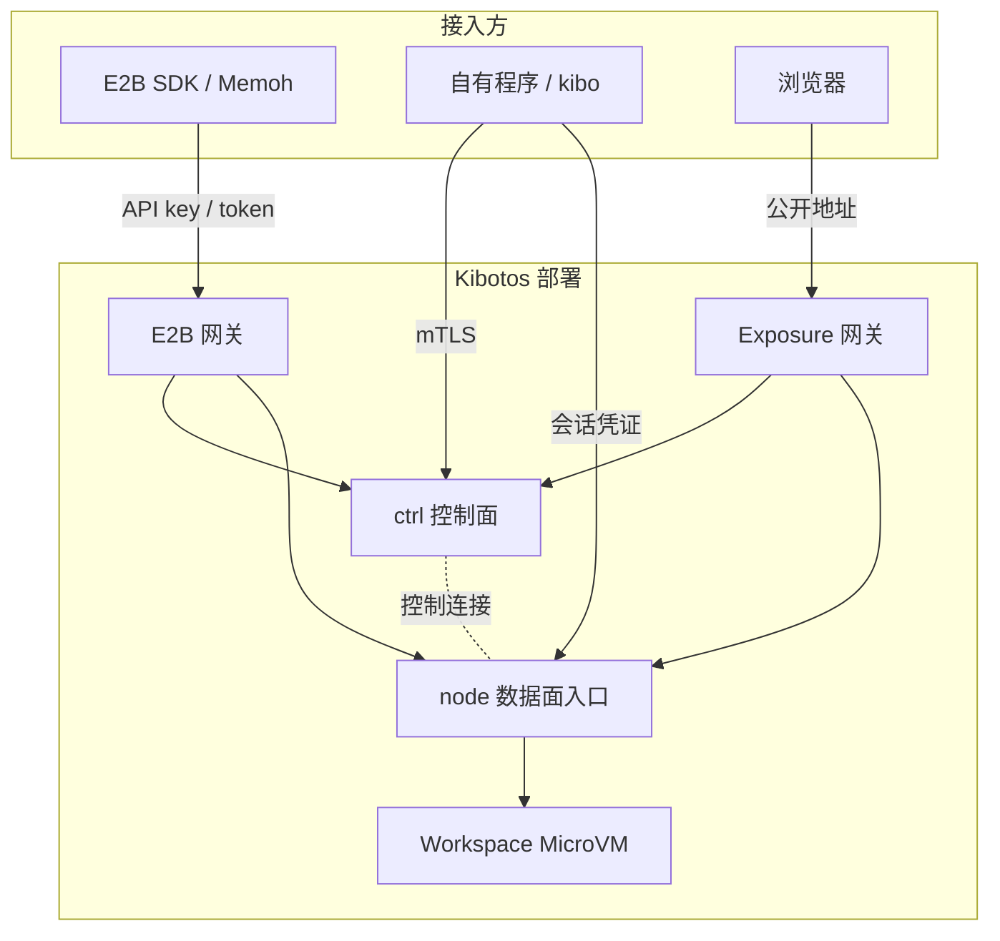
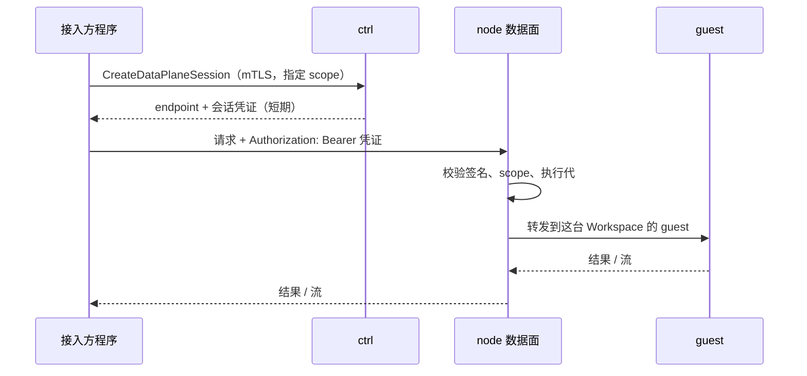

# 系统架构

本页从接入方的角度说明 Kibotos 由哪些组件构成、一次请求经过哪里、数据存在哪里，以及组件故障时 Workspace 会怎样。适合需要评估集成方式与可用性的架构师。

## 概述 {#overview}

Kibotos 把请求分成两条路径：

- **控制面**：创建、启动、停止、删除 Workspace，修改配置，查询状态。请求发给 ctrl，用 mTLS 客户端证书认证。
- **数据面**：执行进程、读写文件、操作桌面、连接 guest 内的端口。请求直接发给运行这个 Workspace 的 node，带 ctrl 签发的短期会话凭证，不经过 ctrl 转发。

## 组件 {#components}

| 组件 | 职责 | 接入方怎样接触它 |
|---|---|---|
| ctrl | 保存 Workspace、Volume、Transfer、Egress、Resolver、Exposure 的权威状态；接受写命令并执行到底；把 Workspace 调度到 node；执行到期动作；签发数据面会话凭证 | 原生 API 与 `kibo` 的唯一入口，mTLS 认证 |
| node | 运行 MicroVM，管理每台 VM 的存储、网络与 VMM；提供数据面入口 | 带会话凭证访问数据面；地址由 ctrl 在会话响应里给出 |
| guest | MicroVM 里的 agent：启动受管进程、读写文件、驱动桌面、上报运行状况 | 不直接接触，经数据面使用 |
| E2B 网关 | 把 E2B 的控制 API、envd 协议与应用端口翻译成原生 API 与数据面请求 | E2B SDK 与 Memoh 的入口，API key 认证 |
| Exposure 网关 | 把 Workspace 内的 HTTP 端口发布成公开的 `https://` 地址 | 打开公开地址的浏览器；只有平台运营方开启这项功能时存在 |

平台侧还有 ctrl 使用的数据库（保存权威状态）与对象存储（保存 Template、Platform 制品与 Transfer 归档），由平台运营方运营。

## 请求路径 {#request-paths}

### 控制面请求 {#control-path}

原生 API 与 `kibo` 用 Connect 协议（HTTP/2、TLS 1.3）调用 ctrl，客户端出示 Operator 身份的客户端证书，并只信任 ctrl 自己的服务端 CA。写操作都带幂等键：ctrl 先把命令记下来再执行，重复提交同一个幂等键得到同一个结果。详见[调用约定](/integrate/native-api/conventions)。

### 数据面请求 {#data-path}

访问文件、进程、桌面或端口分两步：

- 会话凭证由 ctrl 签名，node 用自己的时钟校验，ctrl 不在数据路径上。
- 凭证只授予申请时列出的 scope（`FILE_READ`、`FILE_WRITE`、`PROCESS`、`DESKTOP`、`SERVICE_CONNECT`），服务连接还限定到精确的目标端口或 socket。
- 凭证到期只影响新建的请求，已经建立的流继续。Workspace 重新启动进入新的执行代、凭证被撤销时，进行中的流中断。

详见[数据面：文件与进程](/integrate/native-api/data-plane)。

### E2B 请求 {#e2b-path}

E2B 网关本身不运行 VM，也没有自己的数据库：

- 控制 API（`api.<domain>`）的每个请求翻译成一次原生 API 调用；E2B 特有的信息（metadata、创建选项、Volume 名称）随 Workspace 与 Volume 保存在 ctrl 里。
- envd 协议（`49983-<sandboxID>.<domain>`）与应用端口（`<port>-<sandboxID>.<domain>`）的请求只做三件事：核对 token、取缓存的会话凭证、转发到 node 数据面。网关为每个 sandbox 缓存一张绑定这次执行的凭证（最长 1 小时，用掉约 80% 后续签）。
- sandbox 的 envd token 与 traffic token 由网关密钥按 sandbox ID 推导，不保存。

因此网关可以多实例同时服务，任一实例重启不影响 sandbox。详见 [E2B 兼容 API](/integrate/e2b/overview)。

### 公开 URL 请求 {#exposure-path}

开启 Exposure 的部署把一个专用域名整体交给 Exposure 网关。浏览器打开 `https://<随机标签>.<zone>` 时，网关向 ctrl 解析这个地址，ctrl 同时为那个精确端口签发一张只服务这一次请求的凭证，网关再连到 node 数据面。地址是随机的，没有其他访问控制。详见[公开 URL](/integrate/native-api/exposure)。

## 命令的执行方式 {#command-execution}

- **先记录、后执行。** ctrl 接受一条写命令时先把它和幂等键一起记下，之后由 ctrl 自己执行到底：ctrl 重启或 node 短暂不可达时，它会继续重试，不需要调用方重发。
- **返回时机因命令而异。** 创建与启动受理即返回，Workspace 处于 `CREATING` 或 `STARTING`；停止、删除最多等 1 分钟，超时返回可重试的 `unavailable`，命令仍在执行。结果用 `GetWorkspaceCommand` 查询。
- **到期由 ctrl 执行。** 调用方设置的到期时间保存在 ctrl，到期后由 ctrl 停止或删除 Workspace，调用方的进程退出不影响它。
- **观测与状态分开。** guest 不再回应、内存饱和、Egress 故障等是观测结果，不改变 Workspace 的状态。

## 调度与资源 {#placement}

- 创建与启动时，ctrl 把 Workspace 调度到一台有足够 CPU、内存与存储容量、并且具备所需能力的 node。例如带目的地规则、Egress 或 Resolver 的网络策略只会交给支持它的 node；没有这样的 node 时返回 `failed_precondition`，原因 `CAPABILITY_UNAVAILABLE`。
- 容量不足时返回 `resource_exhausted`（E2B 网关返回 503）。可以稍后重试，或者调小资源后重试。
- 内存按请求值分配；vCPU 数是请求的毫核数除以 1000 向上取整。根文件系统可写层的容量从调度起就在 node 的存储池中预留，实际写入的数据才占用磁盘。

## 存储 {#storage}

| 存储 | 来源与位置 | 生命周期 |
|---|---|---|
| 根文件系统 | Template 的只读镜像，node 按需下载并缓存 | 不可变；同一个 Template revision 的所有 Workspace 共用 |
| 可写层 | 每个 Workspace 一份，叠在根文件系统之上 | 停止后尽力保留在 node 上（保留的可写层），可能因 Template 变化或缺失而重建 |
| Volume | node 存储池中的块文件，挂进 guest（默认 `/data`） | 独立于执行存在，停止、启动、换 node 后仍在；按绑定设置随 Workspace 删除或保留 |
| Transfer 归档 | 平台的对象存储 | 导出后保留一段时间（默认 24 小时），用于导入成新的 Volume |

需要承诺保留的数据只写进 Volume。详见[数据持久性与保护](/security/data)。

## 虚拟化后端 {#backends}

Firecracker 与 KiboVM 都是正式后端，每台 node 使用其中一种。两者对接入方暴露相同的 API，差异体现在少数行为上：

| 行为 | Firecracker | KiboVM |
|---|---|---|
| guest 自己复位（`reboot -f` 等） | 在同一个 Instance 上换一个新的 VMM，Workspace 保持 `AVAILABLE` | 按故障处理，Workspace 进入 `FAILED` |
| guest 自己关机（`poweroff -f`） | VMM 不随之结束 | ctrl 按强制停止释放执行，Workspace 进入 `STOPPED` |
| 正常停止的落盘确认 | guest 同步文件系统后停止 | 另外确认每块可写盘写到了存储设备，没确认时 `durability` 为 `STOP_DURABILITY_UNCONFIRMED` |

详见[运行状况观测](/integrate/native-api/observability)。

## 可用性特征 {#availability}

| 情况 | 影响 |
|---|---|
| ctrl 暂时不可用 | 控制面请求失败。已签发的会话凭证在有效期内仍能访问数据面；到期动作在 ctrl 恢复后按保存的时间执行。同一时刻只运行一个 ctrl |
| node 服务重启或在同一发布线内升级 | 运行中的 MicroVM 不受影响，数据面连接不断开 |
| E2B 网关某个实例重启 | 其他实例继续服务；sandbox 与 token 不受影响 |
| guest 不再回应 | Workspace 仍是 `AVAILABLE`，数据面请求超时；一直不恢复时强制停止再启动 |
| 宿主内存耗尽杀掉某台 VM | ctrl 自行强制停止这个 Workspace，进入 `STOPPED`，可以直接启动；E2B sandbox 表现为暂停 |
| VMM 意外退出 | Workspace 进入 `FAILED` 并仍占着资源，强制停止后再启动 |

## 下一步 {#next}

- [核心概念](/guide/concepts)
- [Workspace 生命周期](/guide/workspace-lifecycle)
- [安全模型](/security/overview)
