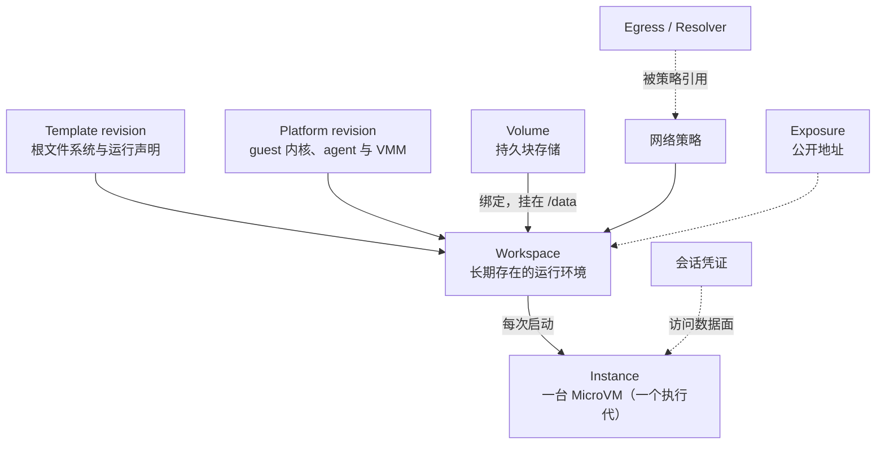

# 核心概念

本页定义文档中反复出现的概念，并说明它们之间的关系。阅读接入指南之前建议先读一遍。术语的中英对照见[术语表](/reference/glossary)。

## 关系总览 {#overview}

## Workspace {#workspace}

Workspace 是一个 Agent 运行环境的**长期对象**。它记录：

- 使用哪个 Template revision；
- 请求的 CPU、内存与根文件系统可写层容量；
- 绑定的 Volume 与挂载路径；
- 网络策略；
- 到期设置；
- 调用方自己的 labels 与 annotations。

Workspace 有状态：`CREATING`、`STARTING`、`AVAILABLE`、`STOPPING`、`STOPPED`、`DELETING`、`DELETED`、`FAILED`、`UNKNOWN`。只有 `AVAILABLE` 时才能访问数据面。状态之间的转换见 [Workspace 生命周期](/guide/workspace-lifecycle)。

E2B 兼容 API 里的 **sandbox** 就是一个 Workspace，sandbox ID 就是 Workspace ID。用原生 API 或 `kibo` 可以直接查询经 E2B 创建的 sandbox。

## Instance 与执行代 {#instance}

- **Instance**：Workspace 每次启动时在某台 node 上创建的一台 MicroVM，连同它占用的 CPU、内存、网络与存储挂载。停止时 Instance 被销毁、资源释放。
- **执行代**（generation）：Workspace 每启动一次得到一个新的执行代。数据面会话凭证绑定在执行代上：Workspace 重新启动后，上一个执行代的凭证与进行中的流一律失效。申请凭证时可以带 `expected_generation`，确保拿到的凭证属于你认为的那一次执行。
- **持有执行**：Workspace 在某台 node 上还有没释放的 Instance 与资源预留。`FAILED` 的 Workspace 可能仍持有执行，这时要先强制停止才能再启动。

## Template {#template}

Template 定义 Workspace 的根文件系统与运行方式：

- 一个只读的根文件系统镜像，通常由 Containerfile 构建；
- 受管进程的默认值：默认账号、shell、PATH；
- guest 提供哪些能力，例如文件、进程、桌面；
- 桌面型 Template 还声明桌面会话与屏幕。

每次构建发布得到一个不可变的 **revision**。每个 Template 有一个**默认 revision**；创建 Workspace 时不指定 revision 就使用默认的那个，并把它固定在 Workspace 上，之后默认 revision 变化不影响已有的 Workspace。可用的 Template 由平台运营方发布与批准。详见 [Template 与 Platform](/templates/overview)。

## Platform {#platform}

Platform 是 guest 内核、guest agent 与 VMM 运行时的组合，按后端分为 Firecracker 与 KiboVM 两种。Platform 同样有 revision，由平台运营方批准并设置默认值。Workspace 启动时使用的 Template revision 与 Platform revision 组合称为一次 **Launch**。

Template revision 固定在 Workspace 上，Platform 则在显式启动时按当前的默认 revision 重新选取，所以 guest 侧的改进在 Workspace 下次启动后生效。接入方一般不需要直接选择 Platform。

## Volume {#volume}

Volume 是独立于 Workspace 存在的持久块存储：

- 挂在 Workspace 的一个绝对路径上，默认 `/data`。这是**唯一承诺在停止与启动之间保留数据**的路径。
- 同一时刻最多绑定一个未删除的 Workspace。Workspace 不运行时可以换绑、改挂载路径或解绑。
- 绑定有一个「随 Workspace 删除」开关：随 Workspace 新建的 Volume 默认打开，绑定已有 Volume 时默认关闭。
- 只能扩容，不能缩容；扩容要在 Volume 未挂载时进行。

状态：`CREATING`、`AVAILABLE`、`ATTACHED`、`RESIZING`、`DELETING`、`DELETED`、`FAILED`、`UNKNOWN`，以及平台运营方宣告存储丢失后的 `LOST`。

## 可写层 {#writable-layer}

根文件系统本身不可变，Workspace 对它的修改写在一个属于这个 Workspace 的**可写层**里。Workspace 停止后，可写层尽力保留在 node 上（**保留的可写层**，retained layer），下次启动时复用。可写层缺失或 Template 变化时可能重建，所以它不是快照，不能用来承诺数据保留。`/tmp`、`/run` 在每次启动时都是空的。

可写层的容量在创建时指定，之后只能增大。

## Transfer {#transfer}

Transfer 把一个已停止 Workspace 的 Volume 内容导出成归档，再导入成新的 Volume，用它恢复出新的 Workspace。归档存放在平台的对象存储中，有保留期。Volume 根目录下的 `.kibotos/credentials` 与 `.kibotos/browser-state` 不导出。详见 [Volume 与 Transfer](/integrate/native-api/volumes-transfers)。

## 网络策略 {#network-policy}

每个 Workspace 有一份网络策略，决定 guest 能访问哪些外部地址：

| 组成 | 含义 |
|---|---|
| `mode` | `DENY_ALL`（原生 API 的默认值）或 `PUBLIC_INTERNET` |
| `allow`、`deny` | 在 `PUBLIC_INTERNET` 下按目的地址或网段收窄 |
| `egresses` | 让指定网段的 TCP 连接经调用方的 Egress 离开 |
| `resolvers` | 把 guest 的 DNS 查询交给调用方的 Resolver |

私有与特殊用途地址在任何 mode 下都不能直接访问。策略有 `revision`，修改运行中的 Workspace 时在新策略生效后才返回。详见[网络策略与 DNS](/integrate/native-api/network-policy)。

## Egress 与 Resolver {#egress-resolver}

- **Egress**：调用方运营的 SOCKS5 出口端点（可选 TLS 与用户名口令）。被网络策略引用后，发往指定网段的 TCP 连接经它离开；出口不可用时连接失败，不会改为直连。
- **Resolver**：调用方选定的 DNS 上游，支持 UDP、TCP、DNS over TLS 与 DNS over HTTPS，可以直连，也可以经 Egress 访问内网里的解析器。

两者都是独立的对象，可以被多个 Workspace 引用；被引用时不能删除。详见 [Egress 与 Resolver](/integrate/native-api/egress-resolver)。

## Exposure {#exposure}

Exposure 把 Workspace 里一个 HTTP 端口发布成一条公开的 `https://` 地址，带有效期（最长 24 小时）。Workspace 停止或删除时，它的全部 Exposure 一并撤销；再次启动后要新建一条，得到新的地址。地址是随机的，没有其他访问控制。只有平台运营方开启了这项功能时才可用。详见[公开 URL](/integrate/native-api/exposure)。

## 会话凭证与服务连接 {#session}

- **会话凭证**：访问数据面时带的短期 bearer 值，由 ctrl 签发。申请时指定 scope：`FILE_READ`、`FILE_WRITE`、`PROCESS`、`DESKTOP`、`SERVICE_CONNECT`。默认有效 5 分钟，最长 15 分钟；也可以申请绑定这次执行的凭证（最长 1 小时）。
- **服务连接**：把调用方的字节流接到 guest 内某个 TCP loopback 端口或 Unix socket，例如 VNC、Chrome DevTools 或应用端口。凭证只对申请时列出的精确目标有效。

详见[数据面：文件与进程](/integrate/native-api/data-plane)与[桌面与服务连接](/integrate/native-api/desktop-services)。

## labels 与 annotations {#labels-annotations}

Workspace、Volume、Egress 与 Resolver 各有两组调用方自己的键值数据：

- **labels**：短值，可以在列表接口里按它筛选，规则沿用 Kubernetes。
- **annotations**：原样存取的任意文本，不能筛选。

ctrl 不解释它们，不据此调度、授权或计费。它们对所有能读这个资源的调用方可见，不要放密钥。`kibotos.app` 及其子域名形式的前缀留给 Kibotos 自己的组件，例如 E2B 网关使用 `e2b.kibotos.app/`。

## Operator 身份 {#operator-identity}

调用原生 API 与使用 `kibo` 的客户端都需要一份 **Operator 身份**：由 ctrl 签发的客户端证书，有效期 30 天，自动或手动续期。身份通过一次性的**注册密钥**换取。当前版本中，已注册的 Operator 对所在部署拥有完整的管理权限。详见[身份、凭证与访问控制](/security/credentials)。

## 幂等键、版本校验与能力名 {#conventions}

- **幂等键**（command ID）：每个写请求带一个客户端生成的 ID。同一个 ID 加同样的输入重放，得到第一次的结果，不会重复执行；输入不同则返回 `already_exists`。
- **版本校验**（expected revision）：修改已有对象时带上读到的版本号，期间被别人改过时服务端拒绝，不会覆盖别人的修改。
- **能力名**（capability）：服务端在 `GetServerInfo` 里宣告自己支持的能力，例如 `workspace.stop.force`。客户端按名字判断某个操作是否可用。

详见[调用约定](/integrate/native-api/conventions)。

## 下一步 {#next}

- [Workspace 生命周期](/guide/workspace-lifecycle)
- [系统架构](/guide/architecture)
- [术语表](/reference/glossary)
