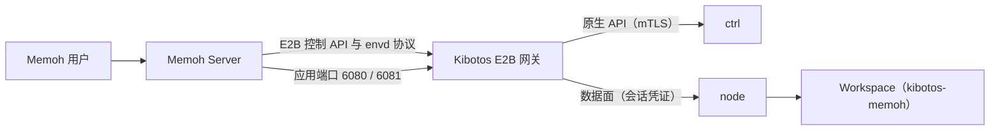

# Kibotos 与 Memoh

本页说明 Memoh 的 bot 工作区怎样运行在 Kibotos 上：Memoh Server 经哪条路径使用 Kibotos、`kibotos-memoh` Template 里有什么、哪些目录在重启后保留。读者是使用 Memoh、或在 Kibotos 上构建类似 Agent 平台的团队。

## 概述 {#overview}

Kibotos 与 Memoh 出自同一团队。Memoh 是 AI Agent 平台，它为每个 bot 准备一个可以执行命令、安装工具、操作浏览器与桌面的工作区，这个工作区就是一个 Kibotos Workspace：

- Memoh Server 通过 Kibotos 的 **E2B 兼容网关** 创建、暂停、恢复与删除工作区，执行命令、读写文件。网关对 Memoh 自带的 Go 客户端与官方 E2B SDK 使用同一套线上格式。
- 工作区使用 **`kibotos-memoh`** Template：无头 X11 桌面、Chromium、无障碍助手（a11y-cli），以及固定版本的 Node.js、npm、Python 与 uv。
- 桌面与浏览器经 E2B 的 **应用端口** 访问。按 Memoh 这类调用方的约定，6080 是 noVNC 桌面入口，6081 是 websockify 端口网关，浏览器的 Chrome DevTools 端点在 guest 内的 9222。网关只转发端口，端口上的服务要在 guest 里运行。

## bot 与 Kibotos 对象的对应 {#mapping}

| Memoh 侧 | Kibotos 侧 | 说明 |
|---|---|---|
| bot 的工作区 | E2B sandbox，即一个 Workspace | sandbox ID 在暂停与恢复之间不变 |
| bot 的标识 | sandbox metadata，例如 `bot_id` | 网关把 metadata 条目写成 Workspace 的 label（前缀 `m.e2b.kibotos.app/`），可以按它筛选，例如 `kibo workspace list -L m.e2b.kibotos.app/bot_id` |
| 工作区里需要长期保留的数据 | 挂在 `/data` 的 Volume | 暂停、恢复、Template 换版本后仍在 |
| 工作区空闲 | 暂停（冷暂停） | 停止执行、释放 CPU 与内存，Volume 保留 |
| 工作区恢复 | `connect` | 冷启动新的执行，重新挂载 Volume；内存与进程不保留 |

暂停与恢复的完整语义见[暂停与恢复](/integrate/e2b/pause-resume)。

## kibotos-memoh Template {#template}

| 项 | 内容 |
|---|---|
| Template ID | `kibotos-memoh` |
| 底座 | Debian 13（trixie），`linux/amd64` |
| 根文件系统 | 4096 MiB |
| 默认账号 | `user`（uid/gid 1000），有免密 `sudo` |
| 默认 shell | `/bin/bash` |
| 默认 PATH | `/data/.memoh/deps/bin:/opt/memoh/toolkit/bin:/usr/local/sbin:/usr/local/bin:/usr/sbin:/usr/bin:/sbin:/bin` |
| guest 能力 | 文件、进程、应用配置、Unix socket 服务、桌面 |
| 桌面 | Xvfb + XFCE + x11vnc，1280×960，按需启动 |
| 浏览器 | Debian 归档的 Chromium，保留浏览器自身的沙箱 |
| 字体 | DejaVu、Noto CJK（中文）、Noto Color Emoji |

### 工具链 {#toolkit}

工具链固定在 `/opt/memoh/toolkit`，来自上游发行物而不是 Debian 归档：

| 工具 | 版本 |
|---|---|
| Node.js | 24.22.1 |
| npm | 10.9.9 |
| CPython | 3.14.8 |
| uv | 构建时的最新版本 |

`/opt/memoh/toolkit/bin` 下的启动器（`node`、`npm`、`npx`、`python`、`python3`、`pip`、`pip3`、`uv`、`uvx`）是工具链唯一的入口。

### 工作区安装的依赖 {#deps}

Agent CLI（例如 `codex`、`claude`）**不在镜像里**，由工作区自己安装到 `/data/.memoh/deps`。`/data/.memoh/deps/bin` 排在 PATH 的最前面，所以工作区安装的版本总是先被找到；它在 Volume 上，暂停与恢复之后仍在。

### 显示与浏览器脚本 {#scripts}

`/opt/memoh/scripts/` 下的脚本由 Memoh Server 按绝对路径执行：

| 脚本 | 作用 |
|---|---|
| `memoh-display-env.sh` | 提供 `DISPLAY` 与 `XAUTHORITY`；桌面还没启动时先向 guest 请求桌面，等 X 与 VNC 就绪再返回 |
| `display-prepare.sh` | 准备显示环境并启动浏览器，直到调试端点应答 |
| `display-browser.sh` | 打开浏览器的唯一入口：显示准备、dock、应用菜单与默认浏览器都经它启动，共用一个 profile 与调试端点 |
| `display-apply-style.sh` | 为调用方保留的入口，桌面样式已随镜像就绪 |

无障碍助手的入口是 `/opt/memoh/toolkit/display/bin/a11y-cli`，供 Memoh 的 Computer Use 工具读取界面的无障碍树。

### 浏览器 {#browser}

| 项 | 内容 |
|---|---|
| profile | `/data/.memoh/browser`，在 Volume 上：Cookie、站点存储与登录状态在重启、换 Template 版本后保留（v0.2.1 起；此前在 `/tmp`，每次重启丢失） |
| HTTP 缓存 | home 目录下，不进 Volume |
| 调试端点 | guest 内 `127.0.0.1:9222` |
| 托管策略 | 关闭组件更新、本地基础模型下载、后台模式与指标上报 |
| 启动参数 | `/etc/chromium.d/memoh`，所有启动方式共用 |

::: warning 浏览器 profile 是敏感数据
profile 里的 Cookie 用 Chromium basic 存储的固定密钥加密，能读到这个 Volume 的一方就能取得其中的登录状态。经 Transfer 导出 Volume 时，`/data/.memoh/browser` 会一起导出（只有 Volume 根目录下的 `.kibotos/credentials` 与 `.kibotos/browser-state` 不导出）。见[数据持久性与保护](/security/data)。
:::

## 数据保留 {#persistence}

| 位置 | 暂停与恢复之后 |
|---|---|
| `/data`（Volume），包括 `/data/.memoh/deps` 与 `/data/.memoh/browser` | 保留 |
| 根文件系统的其他位置，例如 home 目录 | 尽力保留，可能因可写层重建而丢失 |
| `/tmp`、`/run` | 不保留 |
| 内存、运行中的进程、浏览器的打开页面 | 不保留 |

浏览器约 30 秒才把 Cookie 写入磁盘一次，暂停不等浏览器正常退出，最近一小段时间里的 Cookie 变化可能丢失。

## 桌面与端口 {#desktop-ports}

Memoh 这类调用方经 E2B 应用端口使用桌面与浏览器，约定的端口如下。E2B 网关只按 `{port}-{sandboxID}.<domain>` 转发，不提供这些服务：6080、6081 上的 noVNC 与 websockify 要在 guest 里运行，`kibotos-memoh` 镜像本身不带它们。

| 端口 | 用途 |
|---|---|
| 6080 | guest 内 noVNC / websockify 的桌面入口 |
| 6081 | guest 内 websockify 的端口网关，`/?token=9222` 这类查询参数选择 guest loopback 上的目标端口；它不是网关的 traffic token，网关原样传递 |
| 9222 | Chrome DevTools 端点，由 `display-browser.sh` 启动的浏览器提供，通常经 6081 访问 |

经 6081 转发时，内层请求的 Host 是 loopback，Chromium 会接受；直接访问公开的 9222 时 Chromium 可能因为 Host 不是 loopback 而拒绝。详见[应用端口与桌面](/integrate/e2b/ports)。

不经 E2B 网关时，也可以用原生 API 的服务连接直接连到桌面的 VNC socket 或 guest 内的 9222，见[桌面与服务连接](/integrate/native-api/desktop-services)。

## 下一步 {#next}

- [内置 Template](/templates/builtin)
- [暂停与恢复](/integrate/e2b/pause-resume)
- [应用端口与桌面](/integrate/e2b/ports)
- [桌面 Template 规范](/templates/desktop)
