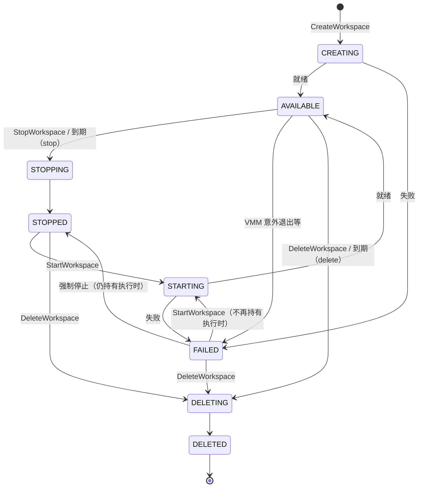

# Workspace 生命周期

本页说明 Workspace 有哪些状态、哪些操作让它在状态之间转换、出现故障时怎样恢复。原生 API 与 `kibo` 的接入方都需要先理解这里的模型；E2B 接入方可以只看最后一节的对应关系。

## 状态 {#states}

| 状态 | 含义 | 数据面 | 可以执行的操作 |
|---|---|---|---|
| `CREATING` | 创建命令已受理，正在调度与创建第一个 Instance | 不可用 | 等待；删除 |
| `STARTING` | 启动命令已受理，正在创建新的 Instance | 不可用 | 等待；删除 |
| `AVAILABLE` | Instance 运行中，guest 已就绪 | 可用 | 停止、强制停止、删除、改网络策略、改到期时间、撤销数据面凭证 |
| `STOPPING` | 正在停止 | 不可用 | 等待；强制停止；删除 |
| `STOPPED` | 没有 Instance；Volume 与保留的可写层都在 | 不可用 | 启动、删除、调整资源、换绑 Volume、导出、改网络策略（下次启动生效） |
| `FAILED` | 某个操作或这次执行失败，`failure` 字段说明阶段与原因 | 不可用 | 视是否仍持有执行而定，见[失败与恢复](#failure) |
| `DELETING` | 删除命令已受理，正在释放资源 | 不可用 | 再次删除（等待同一次删除完成） |
| `DELETED` | 已删除，记录仍可查询 | 不可用 | 查询 |
| `UNKNOWN` | ctrl 暂时无法确定的观测状态，例如停止的结果尚未确认 | 不可用 | 查询；强制停止；删除 |

图中省略了从 `CREATING`、`STARTING`、`STOPPING`、`UNKNOWN` 直接删除的转换，以及强制停止从 `AVAILABLE`、`STOPPING`、`UNKNOWN` 到 `STOPPED` 的转换。labels 与 annotations 在 Workspace 删除之前的任何状态都可以修改。

## 创建与启动 {#create-start}

- `CreateWorkspace` 与 `StartWorkspace` 受理即返回，Workspace 处于 `CREATING` 或 `STARTING`，之后由 ctrl 执行到底。用 `GetWorkspaceCommand` 或轮询 `GetWorkspace` 等它变为 `AVAILABLE`。`kibo` 默认替你等待。
- 每次启动都创建新的 Instance，进入新的执行代。之前的进程与内存不恢复；Volume 重新挂载，保留的可写层在可用时复用。
- 资源、Volume 绑定的修改都在下一次启动时生效。
- 创建或启动因容量不足失败时，可以稍后重试，或调小资源后重试。

## 停止 {#stop}

正常停止（默认）按下面的顺序进行：

1. 关闭这个 Workspace 的数据面，进行中的数据面连接结束。
2. 请 guest 停止写入并同步文件系统。应用已经交给内核的写入会被同步；还在应用自己缓冲区里的数据需要应用自己 flush。
3. 停止 Instance，释放 CPU 与内存。Volume 与可写层保留。

停止完成后响应的 `durability` 为 `STOP_DURABILITY_CONFIRMED`。同步失败或结果未知时，正常停止不会自行改为强制停止。

**强制停止**（`STOP_MODE_FORCE`，`kibo workspace stop --force`）用于正常停止完成不了、或 Workspace 停在 `FAILED` 仍持有执行的情况：它只请 guest 做一次短时间同步，然后停止 Instance、释放资源，`durability` 为 `STOP_DURABILITY_UNCONFIRMED`，最后的写入可能丢失，效果等同一次断电。Volume 与可写层仍然保留。接受与拒绝的条件见 [Workspace](/integrate/native-api/workspaces#force-stop)。

## 到期 {#expiration}

Workspace 可以带一个到期时间与到期动作：

| 到期动作 | 效果 |
|---|---|
| `stop` | Workspace 停止，Volume 与可写层保留，可以再启动 |
| `delete` | Workspace 被删除；随它新建的 Volume 默认一起删除 |

- 到期由 ctrl 执行，倒计时从 ctrl 接受命令时开始，包含创建或启动的耗时。
- 访问文件、执行命令不会延长到期时间。需要延长时显式修改。
- ctrl 已经开始执行到期动作后，不能再通过修改到期时间取消。
- 停止会消费 `stop` 类型的到期设置；启动不恢复已消费的设置。可以在启动、停止时一并设置新的到期时间。

详见 [Workspace](/integrate/native-api/workspaces#expiration)。

## 失败与恢复 {#failure}

`FAILED` 的 Workspace 分两种，响应里没有字段直接区分，按下面的顺序处理即可：

1. 发送强制停止。成功时 Workspace 进入 `STOPPED`。
2. 发送 `StartWorkspace`。第 1 步返回 `failed_precondition` 时同样执行这一步：说明 Workspace 本来就不持有执行。
3. 两步都被拒绝时，重新读取 Workspace，按它当前的状态处理。

开始过删除的 Workspace 只能再次删除，不接受启动、强制停止与配置修改。

## 意外情况 {#unexpected}

| 情况 | Workspace 的状态 | 怎样继续 |
|---|---|---|
| guest 自己重启（Firecracker 后端） | 保持 `AVAILABLE`，执行代与凭证不变；guest 回来之前数据面请求返回可重试的 `unavailable` | 重试。10 分钟内复位超过 3 次时进入 `FAILED` |
| guest 自己关机（KiboVM 后端） | ctrl 自行强制停止，进入 `STOPPED`，停止原因 `STOP_CAUSE_GUEST_SHUTDOWN` | 直接启动 |
| 宿主内存耗尽，VM 被内核杀掉 | 短暂 `FAILED`，随后 ctrl 自行强制停止，进入 `STOPPED`，停止原因 `STOP_CAUSE_HOST_MEMORY_EXHAUSTED` | 直接启动 |
| VMM 意外退出（被杀、guest 内核崩溃等） | `FAILED`，仍持有执行 | 强制停止，再启动 |
| guest 不再回应，VMM 仍在运行 | 保持 `AVAILABLE`，`guest_observation` 报告不再回应 | 等它自己恢复；一直不恢复时强制停止，再启动 |
| guest 里的进程顶在内存上限 | 保持 `AVAILABLE`，`guest_observation` 报告内存饱和；持续时 guest 杀掉其中占用内存最多的进程 | 调大内存，或强制停止再启动 |

详见[运行状况观测](/integrate/native-api/observability)。

## 删除 {#delete}

- `DeleteWorkspace` 最多等 1 分钟，超时返回可重试的 `unavailable`，删除继续进行。
- 绑定的 Volume 按绑定上的「随 Workspace 删除」开关处理：打开时一起删除，关闭时只解除绑定，Volume 回到 `AVAILABLE`。
- 已删除的 Workspace 仍可以查询，列表接口带 `include_deleted` 时一并返回。
- 想确认执行占用的资源是否已全部释放，查询清理结果：`GetWorkspaceCleanup` 或 `kibo workspace cleanup-status`。

## 与 E2B sandbox 状态的对应 {#e2b-states}

| E2B 呈现 | Workspace 状态 | 说明 |
|---|---|---|
| `running` | `AVAILABLE` | 包括 guest 自己重启期间 |
| `paused` | `STOPPED` | 主动暂停、`autoPause` 到期、宿主内存耗尽、guest 关机，都表现为暂停，`connect` 即可恢复 |
| `paused` | 启动因容量不足失败 | 容量恢复后再 `connect` |
| 失败（`connect` 返回 409，查询返回 502，列表不列出） | `FAILED` 且原因不可重试 | 需要平台运营方强制停止后才能恢复 |
| 不存在（404） | `DELETED` | |

E2B 的暂停是冷暂停：内存、进程与原有连接都不保留，见[暂停与恢复](/integrate/e2b/pause-resume)。

## 下一步 {#next}

- [Workspace](/integrate/native-api/workspaces)
- [运行状况观测](/integrate/native-api/observability)
- [暂停与恢复](/integrate/e2b/pause-resume)
