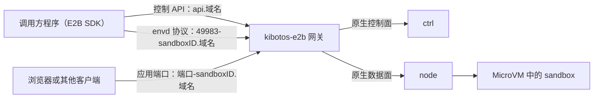

# 概述与兼容范围

本页介绍 Kibotos 的 E2B 兼容网关 `kibotos-e2b`：它怎样把官方 E2B SDK 的请求翻译成 Kibotos 原生 API，调用方要使用哪些域名和凭证，兼容哪个 SDK 版本，支持哪些接口。读者是通过 E2B SDK 或 E2B REST 协议接入的开发者，以及评估接入方案的架构师与安全评审。

第一次接入请先跑通[通过 E2B SDK 接入](/quickstart/e2b-sdk)。

## 概述 {#overview}

`kibotos-e2b` 把 E2B 的控制 API 和 envd 协议翻译成 Kibotos 的原生 API，官方 E2B SDK 指向它就能直接使用 Kibotos。每个 sandbox 是一个运行在 MicroVM 里的 Workspace，sandbox ID 就是 Workspace ID。

- **网关本身不运行 VM。** 创建、停止、执行命令、读写文件都转成对 ctrl 与 node 的原生调用。sandbox 的状态与到期动作由 Kibotos 原生服务维护和执行。
- **网关无状态，可以多实例运行。** 网关没有自己的数据库。metadata、创建选项与 Volume 名称随创建命令保存在 ctrl 中，任何一个网关实例都能服务任何一个 sandbox，换一个实例重试请求得到同样的结果。
- **原生 API 没有的能力，网关不模拟。** 网关做不到的 E2B 能力会明确失败（多数返回 HTTP 501），不会忽略请求里的选项后照常返回成功。完整清单见[明确未提供的能力](/integrate/e2b/differences#unsupported)。

AI Agent 平台 Memoh 的 Memoh Server 也通过这个网关使用 Kibotos，它使用自己的 Go 客户端而不是官方 SDK，见 [Kibotos 与 Memoh](/guide/memoh)。

## 域名 {#domains}

平台运营方为部署分配一个 sandbox 域名，例如 `sandbox.example.com`。调用方按下表的三类域名访问网关，都使用 HTTPS：

| 域名 | 用途 | 凭证 |
|---|---|---|
| `api.<domain>`，例如 `api.sandbox.example.com` | 控制 API：sandbox、Volume、暂停与到期、出网策略、指标 | API key |
| `49983-<sandboxID>.<domain>` | envd 协议：命令、PTY、文件、健康检查 | envd access token |
| `<port>-<sandboxID>.<domain>` | 应用端口：转发到 sandbox 内对应端口的 HTTP 与 WebSocket | 私有 sandbox 需要 traffic token |

- SDK 根据创建参数里的 `domain` 自动拼出后两类域名，`sandbox.getHost(port)` 返回 `<port>-<sandboxID>.<domain>`。
- 控制 API 的地址固定是 `https://api.<domain>`，SDK 的 `apiUrl` 与 `domain` 要对应同一个域名。
- `port` 是 1 到 65535 的十进制数。49983 留给 envd 协议，sandbox 内监听 49983 的应用无法经应用端口访问。

## 凭证 {#credentials}

调用方会用到三种凭证。官方 SDK 在控制 API 与 envd 请求里自动带上 API key 与 envd access token；访问应用端口时由你自己的 HTTP 客户端带上 traffic token。自己实现客户端时按下表设置请求头：

| 凭证 | 从哪里来 | 请求头 | 用途 |
|---|---|---|---|
| API key | 平台运营方提供 | `X-API-Key` | 控制 API 的每个请求 |
| envd access token | 创建与 `connect` 的响应字段 `envdAccessToken`，查询 sandbox 也返回 | `X-Access-Token` | envd 协议的每个请求，`GET /health` 除外 |
| traffic token | 创建与 `connect` 的响应字段 `trafficAccessToken`，查询 sandbox 也返回 | `e2b-traffic-access-token` | 私有 sandbox 的应用端口 |

- **API key 是最高权限的凭证。** 持有 API key 就能列出、操作部署内的全部 sandbox 与 Volume，并能通过查询接口读到任一 sandbox 的两个 token。只在服务端使用它，从文件或密钥管理系统读取，不要放进浏览器或下发给终端用户。
- **API key 由整个部署共用，没有团队。** 同一部署接受的所有 API key 权限相同，看到的是同一批 sandbox，网关不按 API key 隔离资源。团队相关的接口（例如团队指标）返回 501。需要互相隔离的业务应使用不同的部署，见下文[部署命名空间](#namespace)。
- **两个 token 在 sandbox 的整个生命周期内保持不变。** `connect`、暂停与恢复、修改到期时间与修改出网策略都不更换 token，与 E2B 一致。SDK 的 `sandbox.envdAccessToken` 与 `sandbox.trafficAccessToken` 就是这两个值。
- **envd 请求总是需要 envd access token。** 创建参数 `secure` 取什么值都不改变这一点。HTTP basic auth 只用来指定执行账号，见[执行身份](#identity)。
- **token 失效时重新 `connect`。** 平台运营方撤销某个 sandbox 的 token，或停用签发它的密钥之后，旧 token 被拒绝：envd 返回 `unauthenticated`，应用端口返回 401。撤销后最多 30 秒，全部网关实例都开始拒绝旧 token。调用方重新调用 `Sandbox.connect()` 即可拿到当前有效的 token。

凭证与访问控制的整体说明见[身份、凭证与访问控制](/security/credentials)。

## 部署命名空间 {#namespace}

一个 Kibotos 部署（一个 ctrl）上可以运行多套 E2B 网关，每套网关有自己的部署命名空间和自己的 API key。

- 每套网关只看得到自己创建的 sandbox 与 Volume。另一套网关创建的 sandbox，即使 ID 正确，查询、`connect`、envd 与应用端口也都按不存在处理，返回 404；sandbox 指标同样返回 404。
- 不是合法格式的 sandbox ID 或 Volume ID 同样返回 404。
- 平台运营方为你开通的部署对应一个命名空间。需要把不同业务、不同客户的 sandbox 彼此隔离时，可以向平台运营方确认是否为它们分配不同的部署。

## 与原生 API 的关系 {#native-api}

E2B sandbox 在原生 API 和 `kibo` 里就是普通的 Workspace，sandbox ID 即 Workspace ID。同时使用原生 API 的调用方需要知道：

- 网关把 E2B 特有的信息（metadata、创建选项、Volume 名称）保存在 Workspace 与 Volume 的 labels 与 annotations 中，key 使用 `e2b.kibotos.app/` 与 `m.e2b.kibotos.app/` 前缀。这些 key 归网关所有，经原生 API 修改它们会破坏对应的 sandbox。
- labels 与 annotations 对能读到这个 Workspace 的所有调用方可见。metadata 不是秘密，不要在里面放 token、密钥或由它们推出的值。
- 经原生 API 修改了 sandbox 的网络策略时，网关查询返回原生策略里的条目，见[出网策略与出站代理](/integrate/e2b/network)。

原生 API 的用法见[原生 API 概述](/integrate/native-api/overview)。

## 兼容版本 {#compatibility}

| 项 | 版本 |
|---|---|
| 兼容目标 | 官方 JavaScript SDK `e2b@2.49.1`，自 2026-09-13 起固定 |
| 当前验收基线 | `e2b@2.46.1` |

- 接口适配、行为差异分析与验收以 `2.49.1` 为目标，但 `2.49.1` 尚未取得验收结论。
- 已经过验收的是 `2.46.1`。生产接入建议把依赖固定在 `e2b@2.46.1`，升级 SDK 前先在测试环境验证。
- 验收只覆盖 JavaScript SDK。Python 等其他语言的官方 SDK 未经验收。
- 实际支持范围以本站列出的能力为准。行为差异汇总见[与 E2B 的差异](/integrate/e2b/differences)，版本承诺见[兼容策略](/releases/compatibility)。

## 支持的接口 {#supported-apis}

| 范围 | 接口 | 对应的 SDK 用法 | 详见 |
|---|---|---|---|
| sandbox | `POST /sandboxes`、`GET /sandboxes/{id}`、`GET /v2/sandboxes`、`DELETE /sandboxes/{id}` | `Sandbox.create()`、`getInfo()`、`Sandbox.list()`、`kill()` | [sandbox 生命周期](/integrate/e2b/sandboxes) |
| 暂停、恢复与到期 | `POST /sandboxes/{id}/pause`、`POST /sandboxes/{id}/connect`、`POST /sandboxes/{id}/timeout`、`POST /sandboxes/{id}/refreshes` | `pause()`、`Sandbox.connect()`、`setTimeout()` | [暂停与恢复](/integrate/e2b/pause-resume) |
| 出网策略 | 创建请求的 `allow_internet_access` 与 `network`，`PUT /sandboxes/{id}/network` | 创建参数 `allowInternetAccess`、`network`，`updateNetwork()` | [出网策略与出站代理](/integrate/e2b/network) |
| Volume | `POST /volumes`、`GET /volumes`、`GET /volumes/{id}`、`DELETE /volumes/{id}` | `Volume.create()`、`Volume.list()`、`Volume.getInfo()`、`Volume.destroy()` | [Volume](/integrate/e2b/volumes) |
| sandbox 指标 | `GET /sandboxes/{id}/metrics`、`GET /sandboxes/metrics`，部署接入实例指标存储时提供 | `getMetrics()`、`Sandbox.getMetrics()` | [sandbox 指标](/integrate/e2b/metrics) |
| 进程与 PTY | `/process.Process/` 下的 `Start`、`Connect`、`SendInput`、`CloseStdin`、`SendSignal`、`Update` | `commands`、`pty` | [命令、终端与文件](/integrate/e2b/commands-files) |
| 文件 | `/filesystem.Filesystem/` 下的 `Stat`、`MakeDir`、`Move`、`ListDir`、`Remove`、`WatchDir`，以及 `GET /files`、`POST /files` | `files` | [命令、终端与文件](/integrate/e2b/commands-files) |
| 健康检查 | `GET /health` | `isRunning()` | [命令、终端与文件](/integrate/e2b/commands-files) |
| 应用端口 | `<port>-<sandboxID>.<domain>` 上的 HTTP 与 WebSocket | `getHost()` | [应用端口与桌面](/integrate/e2b/ports) |

表外的 E2B 接口分两种：

- 网关已知但无法实现的接口（例如快照、fork、团队指标）返回 HTTP 501，消息写明能力名。
- 网关没有路由的接口返回 404。官方 SDK 可能把这个 404 报告为 sandbox 不存在。

两种情况的清单见[明确未提供的能力](/integrate/e2b/differences#unsupported)。

## 执行身份 {#identity}

envd 协议用 HTTP basic auth 传递执行命令与读写文件的账号：

- 调用方指定了账号时，SDK 发送 `Authorization: Basic base64(用户名 + ":")`。网关把用户名原样交给 node，进程启动、文件系统操作与文件上传下载都以这个账号执行。
- `GET /files` 与 `POST /files` 还接受 envd 协议的 `username` 查询参数。它与 basic auth 同时出现时以 basic auth 为准。
- 没有指定账号时，使用 Template 声明的默认账号。`root` 表示以 root 执行。各内置 Template 的默认账号见[内置 Template](/templates/builtin)。
- 没有指定工作目录（`cwd`）时，进程在执行账号的 home 目录启动，例如 `/home/user` 或 `/root`。home 目录不存在时返回 `not_found`。
- 网关不校验账号名。Template 没有声明的账号名由 node 以 `invalid_argument` 拒绝，错误原样返回给调用方。
- basic auth 只表示身份，认证仍然依靠 `X-Access-Token`。

Template 声明的默认账号在 guest 中不可用时（账号被删除或改名、uid 或 gid 为 0、没有 home 目录），sandbox 照常运行和恢复，只有以这个账号执行的请求失败：

- 进程与文件系统接口返回 `failed_precondition`，`GET /files` 与 `POST /files` 返回 409，消息注明账号与原因，重试不会成功。
- 以 `root` 执行的请求照常可用。以 `root` 恢复这个账号后，暂停再恢复 sandbox 即可恢复正常。

## 下一步 {#next-steps}

- [sandbox 生命周期](/integrate/e2b/sandboxes)：创建选项、查询、删除、到期时间与幂等。
- [暂停与恢复](/integrate/e2b/pause-resume)：冷暂停保留什么、不保留什么。
- [命令、终端与文件](/integrate/e2b/commands-files)：envd 协议的方法、上限与示例。
- [与 E2B 的差异](/integrate/e2b/differences)：未提供的能力、行为差异与 HTTP 状态码。
