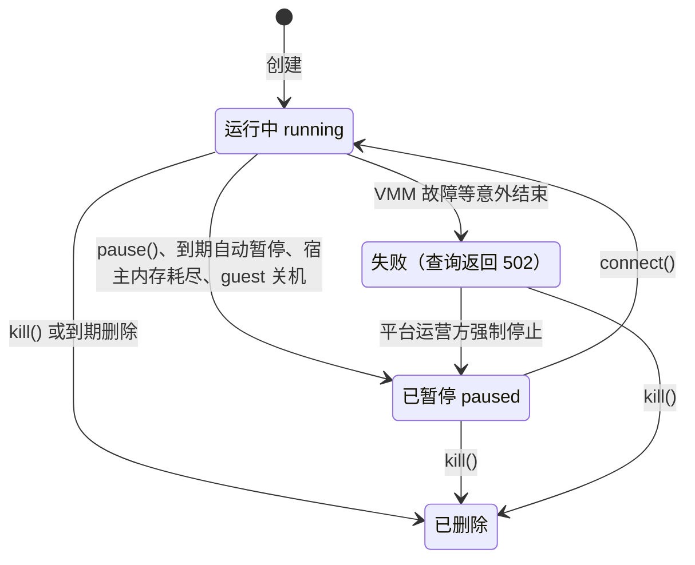

# 暂停与恢复

本页说明 E2B 的暂停与恢复在 Kibotos 上的语义：暂停后哪些数据保留、哪些不保留，各请求在不同状态下的结果，到期自动暂停，以及容量不足、宿主内存耗尽、guest 关机或重启、VMM 故障等情况下 sandbox 会变成什么状态、怎样处理。读者是需要让 sandbox 跨会话保留工作成果的开发者。

## 冷暂停的语义 {#semantics}

E2B 的 `pause` 与 `connect` 接口可用，接受内存暂停请求，包括 SDK 默认发送的 `memory:true`。Kibotos 内部统一采用冷暂停与冷启动恢复：

- **暂停**停止 sandbox 当前的执行，确认停止后返回。
- **恢复**（`connect`）重新启动一次新的执行：重新开机，重新挂载原来的 Volume，并在可用时沿用根文件系统保留的可写层（retained layer）。

暂停再恢复之后：

| 内容 | 结果 |
|---|---|
| sandbox ID、metadata 与创建选项 | 保留 |
| envd access token 与 traffic token | 不变，创建时拿到的 token 照常可用 |
| Volume 里的数据：sandbox 自带的 `/data`，或挂载的独立 Volume | 保留 |
| 根文件系统上的其他修改（例如安装的软件包、写在 home 目录的文件） | 尽力保留。保留的可写层缺失或 Template 变化时会重建，修改随之丢失。它不是快照 |
| `/tmp`、`/run` | 不保留 |
| `/etc/hostname`、`/etc/hosts`、`/etc/resolv.conf` | 每次启动按部署重写，对它们的修改不保留 |
| 内存、运行中的进程、PTY 会话 | 不保留。恢复后是一次新的开机，需要的服务要重新启动 |
| 进行中的连接：envd 的流、应用端口的 HTTP 与 WebSocket | 暂停时断开 |
| 到期时间 | 暂停时清除，恢复时按 `connect` 的 `timeout` 重新设置 |

::: warning 注意
需要可靠保留的数据只写进 Volume 的挂载目录：没有挂载独立 Volume 时是 `/data`，挂载了独立 Volume 时是它的挂载路径。根文件系统上的修改只是尽力保留，不要依赖它。
:::

Kibotos 不提供内存快照、快照恢复与克隆。相关的 E2B 接口（`fork`、快照）返回 501，见[明确未提供的能力](/integrate/e2b/differences#unsupported)。



## 请求行为 {#requests}

| 请求 | sandbox 当前状态 | 结果 |
|---|---|---|
| `POST /sandboxes/{id}/pause`（`sandbox.pause()`） | 运行中 | 执行冷暂停，确认 sandbox 已停止后返回 204，SDK 返回 `true` |
| | 已暂停 | 409 `sandbox is already paused`，SDK 返回 `false` |
| | 正在启动或停止 | 409 `sandbox lifecycle is in progress` |
| | 失败 | 502，消息以 `sandbox failed:` 开头 |
| | 不存在 | 404，SDK 抛出 `SandboxNotFoundError` |
| `POST /sandboxes/{id}/connect`（`Sandbox.connect()`） | 运行中 | 200，只延长到期时间，见[到期时间](/integrate/e2b/sandboxes) |
| | 正在创建或启动 | 等它就绪后返回 200 |
| | 已暂停，或上次启动因可重试的原因失败 | 启动一次新的执行，设置本次的到期时间，等启动完成后返回 201 |
| | 正在停止 | 等停止完成后启动，返回 201 |
| | 启动时没有容量 | 503，消息含 `resource_exhausted`，见[容量不足时的恢复](#capacity) |
| | 因不可重试的原因失败，或在等待期间失败 | 409。sandbox 已处于失败状态时，消息以 `sandbox failed:` 开头 |
| | 不存在 | 404，SDK 抛出 `SandboxNotFoundError` |

- 暂停请求的请求体可以为空，也可以是 `{"memory": true}` 或 `{"memory": false}`，三种都执行冷暂停。SDK 的 `pause()` 默认发送 `memory:true`，`pause({ keepMemory: false })` 发送 `memory:false`，结果相同。请求体不是合法 JSON 时返回 400。
- `connect` 返回的 token 与创建时相同。
- `connect` 最长等待约 90 秒让 sandbox 就绪，SDK 的 `requestTimeoutMs` 应比这更长。
- 暂停在 sandbox 停止后返回。停止超过约 1 分钟时暂停返回 502，停止仍在继续：稍后查询状态，或用同一个 `Idempotency-Key` 重试暂停以拿到最终结果。
- 暂停与 `connect` 都接受 `Idempotency-Key`，见[幂等](/integrate/e2b/sandboxes)。

暂停期间：

- `sandbox.isRunning()` 返回 `false`。
- envd 请求（命令、文件）返回 `unavailable`，应用端口返回 503。先 `connect` 再访问。
- 查询返回 `state: paused`，列表按暂停列出，`lifecycle` 回显下次恢复后使用的到期动作。
- sandbox 不再占用 CPU 与内存，根文件系统的可写空间与 Volume 仍占用存储容量。

## 到期时自动暂停 {#auto-pause}

创建时设置 `lifecycle: { onTimeout: 'pause', autoResume: false }`（REST 的 `autoPause: true`），sandbox 到期时暂停而不是删除：

- `setTimeout()` 与 `connect` 延长到期时间时保持这个设置，恢复后的 sandbox 到期仍然暂停。
- 没有开启自动暂停的 sandbox，手动暂停后再恢复，到期动作仍是删除。
- `lifecycle.onTimeout` 也可以写成 `{ action: 'pause', keepMemory: false }`，与 `'pause'` 的效果相同，都是冷暂停。
- 收到请求时自动恢复（`autoResume: true`）暂不支持，创建返回 501，能力名 `autoResume`。需要恢复时显式调用 `connect`。

## 暂停与到期时间 {#expiration}

- 暂停同时清除到期时间。暂停中的 sandbox 没有到期时间，之前设置的删除动作不会在暂停期间触发，sandbox 一直保留到你删除它。
- 查询暂停中的 sandbox 时，`endAt` 是它最近一次状态变化的时间，通常就是暂停的时间，不表示到期。
- 每个请求的状态变化与到期时间在同一次提交中生效：启动成功的 sandbox 一定已经带有本次的到期时间，暂停成功的 sandbox 一定没有到期时间。恢复失败是例外，见下一节。
- 有效期从 ctrl 接受启动命令时开始计算，启动耗时算在其中。
- sandbox 的实际状态与到期时间以查询结果为准。

不再需要的暂停中 sandbox 要显式删除，否则它们会一直占用存储容量。

## 容量不足时的恢复 {#capacity}

启动 sandbox 时没有 node 能调度它（例如所有 node 的内存都紧张），这次 `connect` 返回 503，消息含 `resource_exhausted`。创建 sandbox 或 Volume 时遇到容量不足同样返回 503。

恢复失败的 sandbox 与上游 E2B 一样仍是暂停：

- 查询返回 `state: paused`，列表按暂停列出，再次暂停返回 409。
- 容量恢复后再次 `connect` 即可启动它，不需要平台运营方介入。按退避间隔重试 `connect` 即可。

到期时间：

- 恢复前没有到期时间的 sandbox（例如暂停中的），恢复失败后仍没有到期时间，超过这次请求的 `timeout` 也不会被暂停或删除。
- 启动命令被 ctrl 接受时就写入了本次的到期时间，网关在启动失败后会清除它。网关恰好在这两步之间停止时，这个到期时间会保留下来；到期动作为删除时，sandbox 会在到期后被删除。

创建时就没能调度成功的 sandbox：

- 创建请求返回 503，但 sandbox 可能已经存在并按暂停列出。用创建时的 metadata 找到它，再 `connect` 启动或删除。
- 它保留创建时的到期时间，到期后按创建时的设置处理。对它的 `connect` 再次失败时，到期时间换成这次请求设置的。

少数情况下，调度失败后 Kibotos 没能释放分给 sandbox 的资源，这时 `connect` 返回 409，重试不会成功。不需要保留数据时可以直接删除它；需要恢复时联系平台运营方处理，之后 `connect` 即可恢复。

## 意外情况 {#unexpected}

下表列出 sandbox 意外停止时的状态与处理方法。内存与运行中的进程在这些情况下都不保留，最后一部分还没写入存储的数据可能丢失。

| 情况 | sandbox 的状态 | 处理 |
|---|---|---|
| 宿主内存耗尽，VM 被宿主内核杀掉 | 自行进入暂停。服务端完成停止之前，查询可能短暂返回 502 | `connect` 恢复 |
| guest 自己关机（`poweroff -f` 等） | 自行进入暂停 | `connect` 恢复 |
| guest 自己重启（`reboot -f` 等），Firecracker 后端 | 仍是 `running`，查询与 `connect` 照常成功 | guest 回来之前，envd 与应用端口的请求失败，重试即可。10 分钟内复位超过 3 次时不再重启，sandbox 进入失败状态 |
| guest 不再回应（例如卡死） | 仍是 `running`，envd 与应用端口的请求超时 | guest 可能自己恢复。一直不恢复时联系平台运营方强制停止，之后 `connect` 恢复 |
| VMM 故障等其他意外结束，包括 KiboVM 后端上 guest 自己重启 | 失败：查询与暂停返回 502，`connect` 返回 409，列表不列出 | 重试不会成功。不需要保留数据时直接删除；需要恢复时联系平台运营方强制停止，之后 `connect` 即可恢复 |

- guest 关机目前只在 KiboVM 后端上会结束这台机器；guest 自己重启目前只在 Firecracker 后端上按重启处理。部署使用哪种后端取决于部署配置，可以向平台运营方确认。原生层面的行为见 [guest 自己重启或关机](/integrate/native-api/observability#guest-reboot)。
- 宿主内存耗尽时服务端自行处理，见[停止原因](/integrate/native-api/observability#stop-cause)。
- 强制停止会保留 Volume 与根文件系统的可写层，最后的写入可能丢失，效果等同一次断电，见[强制停止](/integrate/native-api/workspaces#force-stop)。
- 删除失败的 sandbox 会同时删除它自带的 `/data` Volume。独立 Volume 保留。

## 示例 {#examples}

下面的程序创建一个到期自动暂停的 sandbox，把状态写进 `/data`，主动暂停，再恢复并读回数据。`config` 的写法见[快速开始](/quickstart/e2b-sdk)：

```javascript
import { readFile } from 'node:fs/promises';
import { Sandbox } from 'e2b';

const domain = process.env.E2B_DOMAIN;
const config = {
  apiKey: (await readFile(process.env.E2B_API_KEY_FILE, 'utf8')).trim(),
  domain,
  apiUrl: process.env.E2B_API_URL || `https://api.${domain}`,
  requestTimeoutMs: 180_000,
};

// 到期时暂停，而不是删除
const sandbox = await Sandbox.create(process.env.E2B_TEMPLATE || 'kibotos-minimal', {
  ...config,
  timeoutMs: 15 * 60_000,
  lifecycle: { onTimeout: 'pause', autoResume: false },
  metadata: { task: 'pause-demo' },
});

// 需要保留的数据写进 /data
await sandbox.files.write('/data/state.json', JSON.stringify({ step: 1 }));

// 主动暂停：成功返回 true，已经暂停时返回 false
console.log('paused:', await sandbox.pause());
console.log((await sandbox.getInfo()).state); // paused

// 恢复：重新开机，token 不变；部署暂时没有容量（503）时按退避间隔重试
async function resume(sandboxId) {
  for (let attempt = 0; ; attempt++) {
    try {
      return await Sandbox.connect(sandboxId, { ...config, timeoutMs: 15 * 60_000 });
    } catch (error) {
      if (!/^503: /.test(String(error.message)) || attempt >= 5) throw error;
      await new Promise(resolve => setTimeout(resolve, 2 ** attempt * 1000));
    }
  }
}

const resumed = await resume(sandbox.sandboxId);
console.log(await resumed.files.read('/data/state.json')); // {"step":1}
console.log((await resumed.getInfo()).lifecycle);         // onTimeout 仍为 pause
await resumed.kill();
```

- 官方 SDK 对 401、404 等少数状态使用专门的错误类型，其余错误状态包装成 `SandboxError`，消息以 HTTP 状态码开头，示例据此识别 503。
- 恢复后的 sandbox 是一次新的开机。暂停前在后台运行的服务（例如 Web 服务器）需要重新启动。

## 相关文档 {#related}

- [sandbox 生命周期](/integrate/e2b/sandboxes)：到期时间与幂等。
- [Volume](/integrate/e2b/volumes)：跨 sandbox 保留数据。
- [Workspace 生命周期](/guide/workspace-lifecycle)：原生层面的状态。
- [数据持久性与保护](/security/data)
