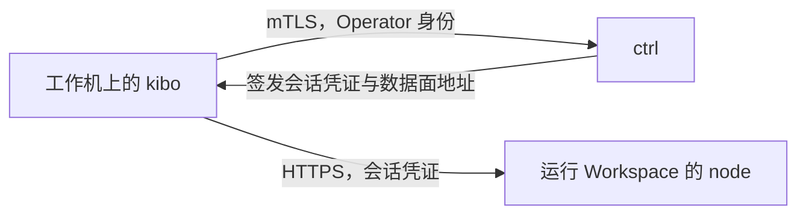

# 安装与连接

本页说明 `kibo` 怎样连接你所接入的 Kibotos 部署：安装、注册、保存连接配置的 context 目录、身份的续期、为其他程序和同事签发身份，以及连接出问题时怎样排查。读者是使用 `kibo` 的接入开发者与负责凭证管理的人。第一次使用时可以先走一遍[通过 kibo 命令行](/quickstart/kibo-cli)。

## 概述 {#overview}

`kibo` 经两条路访问 Kibotos：

| 路径 | 用于 | 认证 | 信任的服务端证书 |
|---|---|---|---|
| 控制面 | 创建、查询、启停 Workspace，管理 Volume、Transfer、Egress、Resolver、Exposure 等 | Operator 身份，即 ctrl 签发的 mTLS 客户端证书 | 只信任注册时保存的 ctrl 服务端 CA |
| 数据面 | 执行命令、终端、文件、服务连接、桌面 | `kibo` 在命令执行期间向 ctrl 申请的短期会话凭证，不写入磁盘 | 系统根证书加上 ctrl 服务端 CA，按标准规则校验主机名 |



- 两条路都不需要额外的 token 或密码。数据面的地址由 ctrl 随会话凭证一起返回，工作机要能访问它。
- 两条路使用同一套代理设置。数据面请求不跟随重定向，只在 TLS 校验通过后才发送会话凭证。

::: warning 身份的权限
已注册的 Operator 对所在部署拥有完整的管理权限，目前没有更细的角色：它可以调用全部 Workspace API 与 Operator API，包括其他调用方创建的 Workspace，以及为别人签发新的 Operator 身份。请把每一份 Operator 身份都当作这套部署的管理员凭证保管，见[身份、凭证与访问控制](/security/credentials)。
:::

## 安装 {#install}

`kibo` 只经 ctrl 的 API 工作，工作机不需要与部署运行在同一个系统上。从平台运营方取得发布包里对应的文件：

| 工作机 | v0.3.0 的文件 |
|---|---|
| Linux，x86-64 | `kibo_0.3.0_linux_amd64` |
| macOS，Apple Silicon | `kibo_0.3.0_darwin_arm64` |
| macOS，Intel | `kibo_0.3.0_darwin_amd64` |

三个构建出自同一次发布构建，功能相同。macOS 的两个构建只核对了构建身份，没有在 macOS 上做过运行验收。

用同一发布包的 `SHA256SUMS` 核对文件，再装到 `PATH` 上：

::: code-group
```bash [Linux]
sha256sum --check --ignore-missing SHA256SUMS
sudo install -m 0755 kibo_0.3.0_linux_amd64 /usr/local/bin/kibo
kibo version --client
```
```bash [macOS]
shasum -a 256 --check --ignore-missing SHA256SUMS
sudo install -m 0755 kibo_0.3.0_darwin_arm64 /usr/local/bin/kibo
kibo version --client
```
:::

`kibo version --client` 不联系 ctrl，显示：

| 行 | 内容 |
|---|---|
| `Version` | 发布版本；未正式发布的构建为 `unreleased` |
| `Revision`、`Commit time`、`Modified` | 构建所用的源码 revision、提交时间、是否有未提交的修改 |
| `Platform` | 操作系统与架构，例如 `linux/amd64` |
| `Signature` | 固定为 `UNSIGNED`：发布物没有发布者签名，`SHA256SUMS` 只用于核对传输完整性 |

注册之后，不带 `--client` 的 `kibo version` 还会联系 ctrl，显示 ctrl 的源码 revision 与宣告的能力数量，`--wide` 列出全部能力名。

## 注册 {#enroll}

`kibo` 用 Operator 身份访问 ctrl。身份保存在本机的一个目录里，称为 context。建立 context 的过程叫注册（enrollment）：把平台运营方或其他 Operator 给你的一次性注册密钥交给 `kibo context enroll`，它向 ctrl 换取正式的身份并保存下来。没有默认的服务器地址，使用任何远程命令之前都必须先注册。

```bash
umask 077
kibo context enroll --endpoint https://ctrl.example.com:18092 --key-file ./operator-enrollment.key
rm ./operator-enrollment.key
kibo context show
```

`context enroll` 依次完成：

1. 用注册密钥里携带的 ctrl 服务端 CA 验证 `--endpoint` 指向的 ctrl。
2. 在本机生成私钥，向 ctrl 出示注册密钥，换取正式身份。私钥不离开本机。
3. 把 ctrl 地址、身份、ctrl 服务端 CA 与可选的代理一起保存到 context 目录。

成功后注册密钥作废，删除密钥文件。

### 地址 {#endpoint}

- `--endpoint` 必须以 `https://` 开头，可以带端口，不能带路径、查询串、片段或用户信息。
- 主机部分是小写的完整域名或 IP 地址，并且要与 ctrl 服务端证书上的主机名一致。使用平台运营方给出的地址，不要换成解析到同一台机器的其他名字。
- `--endpoint` 也可以用环境变量 `KIBO_ENDPOINT` 给出，两者都没有时 `enroll` 报错。

### 提供注册密钥的方式 {#key-sources}

注册密钥包含一把引导私钥和 ctrl 的服务端 CA，要当作凭证保管。它不能通过命令行参数或环境变量传入，只能用下面四种方式之一提供，后三个参数互斥：

| 方式 | 写法 | 说明 |
|---|---|---|
| 终端输入 | 不加参数 | 在终端上无回显地提示 `Enrollment key:`。标准输入不是终端时报错退出，不会转而读取标准输入 |
| 标准输入 | `--key-stdin` | 读到标准输入结束 |
| 文件描述符 | `--key-fd 3` | 读继承的文件描述符，编号不小于 3 |
| 文件 | `--key-file ./operator-enrollment.key` | 普通文件，或指向普通文件的符号链接；FIFO、目录与其他特殊文件被拒绝 |

例如从文件描述符 3 读取：

```bash
kibo context enroll --endpoint https://ctrl.example.com:18092 --key-fd 3 3< ./operator-enrollment.key
```

- 密钥是一个不含空白的 token，首尾的空白与换行会被去掉。
- `--key-file` 指向的文件对 group 或 other 可读时，`kibo` 在标准错误打印警告，仍然读取，不修改源文件。保存密钥文件时把权限设为 `0600`。

### 查看 context {#show}

`kibo context show` 只读本机的 context，不联系 ctrl：

| 行 | JSON 字段 | 内容 |
|---|---|---|
| `Identity` | `identity_uri` | 身份 URI，形如 `spiffe://<信任域>/operator/<id>` |
| `ctrl endpoint` | `endpoint` | 注册时保存的 ctrl 地址 |
| `Forward proxy` | `proxy` | 注册时保存的代理，地址里的用户名和密码被隐去；没有保存时省略 |
| `Certificate serial` | `serial` | 当前证书的序列号 |
| `Valid until` | `not_after` | 当前证书的到期时间 |
| `Renewal due` | `renewal_due` | 是否已进入续期窗口 |
| `Context directory` | `directory` | context 目录的位置 |

JSON 输出另有 `principal_id`（Operator ID）与 `trust_domain`（信任域）。

### context 目录 {#context-directory}

- 默认位置是 `$XDG_CONFIG_HOME/kibo/context`，未设置 `XDG_CONFIG_HOME` 时为 `~/.config/kibo/context`。
- 环境变量 `KIBO_CONTEXT_DIR` 指定另一个位置，必须是绝对路径。需要同时连接多套部署时，为每套部署用一个目录：

  ```bash
  export KIBO_CONTEXT_DIR="$HOME/.config/kibo/staging"
  kibo context enroll --endpoint https://ctrl-staging.example.com:18092 --key-file ./staging-enrollment.key
  ```

- 目录里有 `context.json`（地址与代理）、当前证书 `identity-<serial>.pem` 与私钥 `identity-<serial>.key`、`control-client-ca.pem` 与 `server-ca.pem`。目录由 `kibo` 以 `0700` 创建，里面有私钥，只给使用它的账号访问。
- 目录里已经有身份时，`enroll` 拒绝覆盖。需要重新注册时，先确认不再需要旧身份，删除旧目录，再用新的注册密钥注册。

### 临时改用其他地址 {#endpoint-override}

全局参数 `--endpoint` 或环境变量 `KIBO_ENDPOINT` 只改变这一次请求发往的地址，身份、信任的 CA 与代理仍然来自 context。优先级依次是 `--endpoint`、`KIBO_ENDPOINT`、context 中保存的地址。

```bash
KIBO_ENDPOINT=https://ctrl.example.com:18092 kibo workspace list
```

新地址必须是同一个 ctrl，而且主机名要在它的服务端证书上；否则 TLS 校验失败，退出码 `2`。

### 经代理访问 {#proxy}

- 需要经正向代理访问时，在 `enroll` 命令上加 `--proxy`，支持 `http://` 与 `https://`（CONNECT 代理）以及 `socks5://`，例如 `--proxy http://proxy.example.com:3128`。代理保存在 context 中，之后的命令都经它连接。
- context 中保存了代理时，代理环境变量被忽略。没有保存时，按 `HTTPS_PROXY`、`ALL_PROXY`、`NO_PROXY`（及其小写形式）选择代理；访问 loopback 地址时不使用环境变量中的代理。
- TLS 校验与 mTLS 都在代理隧道内完成。代理地址中的用户名和密码不会出现在输出或日志中。
- 数据面连接使用同一套代理设置。
- `kibo` 没有修改已保存代理的命令。要换代理或去掉代理，删除 context 目录后用新的注册密钥重新注册。

## 有效期与续期 {#renewal}

- 正式身份有效 30 天。剩余不到 10 天时，`kibo` 在访问 ctrl 之前自动续期：在本机生成新私钥，换取新证书。
- 续期失败只在标准错误打印 `warning: operator identity renewal deferred: ...`，命令继续使用尚未过期的身份。
- `kibo context renew` 立即手动续期，同样接受 `--endpoint` 与 `KIBO_ENDPOINT`。
- 身份过期后无法续期：命令报 `operator identity ... has expired; request a new enrollment grant`，退出码 `2`。删除旧的 context 目录，用新的注册密钥重新注册。
- 长期不运行 `kibo` 的机器（例如偶尔触发的任务）要在证书过期前访问一次 ctrl，或定期执行 `kibo context renew`。

## 为程序和同事签发身份 {#issue-identities}

### 一个程序一份身份 {#one-identity-per-program}

ctrl 对每份身份只接受当前与上一张证书。把同一个 context 目录复制给多个程序、多台机器后，各自续期会让其中一些被 ctrl 拒绝。所以：

- 不要复制自己的 context 目录给程序、网关或同事。
- 每个程序、每位同事各用一份身份，各用不同的 Operator ID，各自注册。

### 签发注册密钥 {#create-grant}

已注册的 Operator 可以为另一份 Operator 身份签发注册密钥：

```bash
umask 077
kibo enrollment create --operator ci-runner --ttl 2h --output ./ci-runner.key
```

| 参数 | 说明 |
|---|---|
| `--operator` | 新身份的 Operator ID：1 到 253 个字符，只含字母、数字、`.`、`_`、`-` |
| `--ttl` | 注册密钥的有效期，1 分钟到 24 小时，默认 1 小时 |
| `--output` | 必填。密钥只写入这个文件，权限 `0600`。文件必须不存在，不能是 `-`，也不能是已有的符号链接 |

- 命令输出（包括 `--json`）只有摘要：`grant_id`、`kind`、`subject`、`expires_at` 与 `output_file`。ctrl 不保存完整的密钥。
- 通过私密渠道把密钥文件交给对方，对方用 `kibo context enroll` 注册，或由程序直接调用注册接口，见[身份与认证](/integrate/native-api/authentication)。之后删除两边的密钥文件。
- 带 `--command-id` 重复执行同一条 `create` 时，ctrl 返回原来的 grant，但不再返回密钥：`kibo` 以非零退出码结束，不写输出文件。同一个幂等键配不同的 ID 返回 `already_exists`，退出码 `13`。
- 写输出文件失败时，密钥已经无法再取得。先检查 grant 与文件的状态，必要时撤销这个 ID，不要直接再签发一次。
- 为 node 签发注册密钥（`--node`、`--data-plane-extra-host`）是平台运营方的操作，本站不展开。

目前没有列出全部 Operator 身份的命令。请自己记录签发过的 ID 与用途，不再需要时撤销。

### 撤销 {#revoke}

```bash
kibo enrollment revoke --operator ci-runner --yes
```

- 撤销不可逆，必须加 `--yes`，没有交互确认。
- 撤销作废这个 ID 所有尚未使用的注册密钥，并让它的正式身份立即失效：之后的请求、注册与续期都被拒绝。输出给出作废的注册密钥数（`Revoked grants`）与身份是否被撤销（`Admission revoked`）。
- 撤销不影响已有的 Workspace，也不中断进行中的数据面连接，它们按各自的规则继续。
- 需要让这个程序回来时，重新签发一把注册密钥，再注册一次。
- 身份泄露时的完整处理见[身份、凭证与访问控制](/security/credentials)。

## 输出格式 {#output}

- 默认输出给人读的摘要、详情或表格。表格与详情的布局不是稳定的接口。
- 全局参数 `--json` 输出供脚本解析的 JSON envelope，业务结果在 `result` 字段。`kibo` 的参数与输出不在接口兼容承诺的范围内，升级前查看[变更记录](/releases/changelog)。
- `-q` 只输出结果里的资源 ID，一行一个；`--wide` 加上默认省略的字段，例如各类 revision 与完整 digest。
- `--quiet`、`--wide` 与 `--json` 两两互斥。

字段、错误对象与退出码见 [kibo 命令参考](/reference/kibo-cli#json-output)。

## ID 前缀与补全 {#id-prefix-completion}

- Workspace 与 Volume 的 ID 作为命令的第一个参数时，可以只写能唯一确定它的开头几位，例如 `kibo workspace get ws-01k6`。没有匹配时退出 `12`，有多个匹配时退出 `2` 并列出候选。
- 前缀只在未删除的资源中匹配，也不适用于 `--volume`、`--workspace` 这类参数的值，这些地方要写完整 ID。
- `kibo completion bash`（或 `zsh`、`fish`、`powershell`）输出 shell 补全脚本，例如在 bash 中执行 `source <(kibo completion bash)`。资源 ID 的补全会向 ctrl 读取第一页资源。

完整规则见 [kibo 命令参考](/reference/kibo-cli)。

## 能力检查 {#capabilities}

每条联系 ctrl 的命令都先读取 ctrl 宣告的能力名（capability），确认这个部署支持命令要用的功能，然后才发送请求。缺少能力时命令以退出码 `14` 结束，错误信息为 `server does not advertise capability <能力名>`，请求不会发出。这避免了较旧的服务端忽略不认识的设置、悄悄执行出一个功能更少的结果。

- 部署宣告的全部能力名用 `kibo version --wide` 查看。
- 是否提供某项功能取决于部署配置，例如公开 URL（Exposure）只在平台运营方配置了 Exposure 域名时提供。需要的功能缺失时向平台运营方确认。
- 能力名的含义见[能力名清单](/reference/capabilities)。

## 排查 {#troubleshooting}

| 现象 | 退出码 | 原因与处理 |
|---|---|---|
| `no ctrl context is enrolled; run kibo context enroll` | `2` | 当前 context 目录没有身份。先注册；用了 `KIBO_CONTEXT_DIR` 时确认它指向正确的目录 |
| `kibo context ... is already enrolled; remove it deliberately before enrolling again` | `2` | 目录里已有身份。确认不再需要后删除旧目录，或用 `KIBO_CONTEXT_DIR` 换一个目录 |
| `enrollment key is not a valid kek1 envelope` | `2` | 密钥内容不完整或不是注册密钥，核对文件 |
| `no terminal for a no-echo prompt; use --key-stdin, --key-fd, or --key-file` | `2` | 没有终端可以提示输入，改用这三个参数之一 |
| `context enroll` 报 `enrollment grant is no longer usable`、`enrollment conflicts with an earlier result`，或在 TLS 握手中被拒绝 | `13`；握手被拒时 `15` | 注册密钥已过期、已被撤销或已被使用过，向签发方要一把新的 |
| `this context does not trust the certificate the ctrl endpoint presents` | `2` | `--endpoint`、`KIBO_ENDPOINT` 与 context 不属于同一个 ctrl，核对地址。重试不会成功 |
| ctrl 在 TLS 握手中拒绝客户端证书 | `15`（写命令为 `18`） | 身份已被撤销或已过期。重试不会成功，按上文重新注册 |
| `operator identity ... has expired; request a new enrollment grant` | `2` | 身份已过期，无法续期，重新注册 |
| `warning: operator identity renewal deferred: ...` | 不影响 | 续期没有成功，命令仍用当前身份。检查到 ctrl 的网络后执行 `kibo context renew` |
| `server does not advertise capability ...` | `14` | 部署没有提供这项功能，见[能力检查](#capabilities) |
| `--password is not supported; credentials must not be passed on the command line` | `2` | `kibo` 拒绝在命令行上出现 `--password`、`--token`。口令与密钥按各命令说明的方式提供 |
| 控制面命令正常，`exec`、`file`、`terminal`、`service`、`desktop` 连接失败 | 视命令而定 | 工作机访问不到 node 的数据面地址，或代理没有放行它。向平台运营方确认数据面地址与网络 |

## 下一步 {#next-steps}

- [管理 Workspace](/integrate/kibo/workspaces)
- [kibo 命令参考](/reference/kibo-cli)
- [身份、凭证与访问控制](/security/credentials)
- [身份与认证](/integrate/native-api/authentication)：不用 `kibo`、由程序自己注册与续期。
