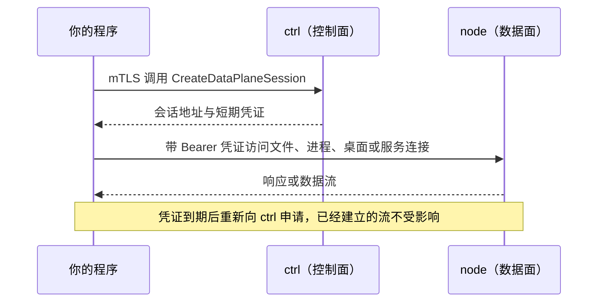

# 概述与协议

本页介绍 Kibotos 原生 API 的整体结构：程序要访问哪两个入口、用什么协议、有哪些服务，以及哪些部分承担兼容承诺。读者是直接用程序调用 API 的集成开发者；第一次接触时可以先跑一遍[通过原生 API](/quickstart/native-api)。

## 概述 {#overview}

原生 API 用 protobuf 定义，传输使用 Connect 协议。调用方（client）需要一份 Operator 身份（identity），即 ctrl 签发的客户端证书，用它以 mTLS 访问控制面（control plane）ctrl；文件、进程、桌面和服务连接则走数据面（data plane），直接访问运行 Workspace 的 node。

接口定义以 proto 文件为准。请向平台运营方获取与所接入部署版本一致的 proto 定义，再用自己选定的生成器生成客户端代码。

## 两个入口 {#entry-points}

| 入口 | 地址 | 认证方式 | 提供的服务 |
|---|---|---|---|
| ctrl（控制面） | 平台运营方给出的地址，例如 `https://ctrl.example.com:18092` | mTLS，客户端证书是注册得到的 Operator 身份 | Workspace API、Operator API、注册与续期，见下文 |
| node（数据面） | `CreateDataPlaneSession` 响应里的 `session.endpoint`，每个 Workspace 可能不同 | HTTP 头 `Authorization: Bearer`，值是会话凭证（data-plane session credential） | 文件、进程、桌面、服务连接，以及 `/v1/files` 与 `/v1/service` 两个 HTTP 入口 |

访问数据面分两跳：先向 ctrl 申请会话凭证，再带着凭证直连 node。数据面的流量不经过 ctrl。

- 控制面与数据面的 TLS 信任规则不同：访问 ctrl 只信任身份目录里的 `server-ca.pem`，访问 node 信任系统根证书加上 `server-ca.pem`。平台运营方可以把 node 放在公网 TLS 反向代理后面。详见[身份与认证](/integrate/native-api/authentication)。
- 申请凭证的规则、数据面上的服务与所需权限见[数据面：文件与进程](/integrate/native-api/data-plane)。

## 协议 {#protocol}

两个入口都使用 [Connect 协议](https://connectrpc.com/docs/protocol)，HTTP/2 over TLS 1.3。

- **请求地址**：`POST` 到 `/包名.服务名/方法名`，例如 `https://ctrl.example.com:18092/kibotos.ctrl.v1.WorkspaceService/GetWorkspace`。
- **内容类型**：一元调用的 `Content-Type` 可以是 `application/proto` 或 `application/json`；流式调用使用 `application/connect+proto`。流式方法需要 HTTP/2。
- **其他协议**：服务端由 connect-go 实现，同时接受 gRPC 与 gRPC-Web。本站的示例以 Connect 协议为准。
- **请求头**：只需要内容类型与认证所需的请求头。协议里没有 API 版本头，对 User-Agent 没有要求；客户端与服务端是否兼容只看能力名（capability），见[能力协商](/integrate/native-api/conventions#capabilities)。
- **重定向**：两个入口都不应跟随 HTTP 重定向。

### JSON 编码 {#json}

使用 `application/json` 时，消息按 protobuf 的标准 JSON 映射编码：

- 请求字段可以写 proto 原名（`workspace_id`）或 JSON 名（`workspaceId`）；响应一律用 JSON 名，即小驼峰形式。
- 枚举写完整名称，例如 `WORKSPACE_STATE_AVAILABLE`。
- `int64`、`uint64` 在响应里是字符串，请求里写数字或字符串都可以。
- `google.protobuf.Duration` 写成 `"3600s"` 这样的字符串，`google.protobuf.Timestamp` 写成 RFC 3339 时间。
- `bytes` 字段是 base64 编码。
- 值为零或为空的字段不出现在响应里，读取时按零值处理。
- 没有参数的一元调用也要发送 `{}`，空请求体会被拒绝。

::: warning 注意
服务端忽略请求里不认识的字段，不会因此报错。拼错的字段名等于没有给出；版本较旧的服务端也会静默丢掉它还不认识的新字段。写入新近加入的字段之前，先确认对应的能力名存在。
:::

### 请求消息大小上限 {#message-size}

ctrl 限制每条请求消息的大小，按所用编码、解压之后计算，超出时返回 `resource_exhausted`：

| 服务 | 上限 |
|---|---|
| `kibotos.enrollment.v1.EnrollmentService` | 64 KiB |
| `kibotos.operator.v1.ArtifactPublicationService` | 16 MiB |
| 其他服务 | 4 MiB |

这些上限高于各个方法实际能接受的最大请求。数据面有自己的上限，例如单条流式消息、单次文件传输与服务连接的消息大小，见[数据面：文件与进程](/integrate/native-api/data-plane)与[桌面与服务连接](/integrate/native-api/desktop-services)。

## Workspace API {#workspace-api}

`kibotos.ctrl.v1` 中运行在 ctrl 上的服务：

| 服务 | 方法 | 用途 | 说明页 |
|---|---|---|---|
| `ServerInfoService` | `GetServerInfo` | 服务端源码版本与能力名列表 | [调用约定](/integrate/native-api/conventions#capabilities) |
| `TemplateService` | `ListTemplates`、`GetTemplate`、`GetTemplateRevision` | 只读的 Template 目录 | [Template 与 Platform](/templates/overview) |
| `WorkspaceService` | `CreateWorkspace`、`GetWorkspace`、`ListWorkspaces`、`StartWorkspace`、`StopWorkspace`、`DeleteWorkspace`、`UpdateWorkspaceExpiration`、`UpdateWorkspaceNetworkPolicy`、`UpdateWorkspaceMemory`、`UpdateWorkspaceCpu`、`UpdateWorkspaceVolumeBinding`、`ResizeWorkspaceWritableLayer`、`RevokeWorkspaceDataPlane`、`UpdateWorkspaceLabels`、`UpdateWorkspaceAnnotations`、`GetWorkspaceCommand` | Workspace 的生命周期与配置 | [Workspace](/integrate/native-api/workspaces) |
| `VolumeService` | `CreateVolume`、`GetVolume`、`ListVolumes`、`ResizeVolume`、`DeleteVolume`、`UpdateVolumeLabels`、`UpdateVolumeAnnotations`、`GetVolumeCommand` | Volume | [Volume 与 Transfer](/integrate/native-api/volumes-transfers) |
| `TransferService` | `ExportWorkspace`、`GetTransfer`、`ImportTransfer`、`RestoreWorkspace`、`DeleteTransfer` | 导出、导入与恢复 | [Volume 与 Transfer](/integrate/native-api/volumes-transfers) |
| `WorkspaceObservationService` | `GetWorkspaceCleanup` | Workspace 的执行释放了哪些部分 | [运行状况观测](/integrate/native-api/observability#cleanup) |
| `DataPlaneSessionService` | `CreateDataPlaneSession` | 申请数据面会话凭证 | [数据面：文件与进程](/integrate/native-api/data-plane#session) |
| `ExposureService` | `CreateExposure`、`GetExposure`、`ListExposures`、`RevokeExposure` | 把 Workspace 内的 HTTP 端口发布为公开地址 | [公开 URL（Exposure）](/integrate/native-api/exposure) |
| `EgressService` | `CreateEgress`、`GetEgress`、`ListEgresses`、`UpdateEgress`、`DeleteEgress`、`UpdateEgressLabels`、`UpdateEgressAnnotations` | 调用方自带的 SOCKS5 出口 | [Egress 与 Resolver](/integrate/native-api/egress-resolver) |
| `ResolverService` | `CreateResolver`、`GetResolver`、`ListResolvers`、`UpdateResolver`、`DeleteResolver`、`UpdateResolverLabels`、`UpdateResolverAnnotations` | 调用方自选的 DNS 上游 | [Egress 与 Resolver](/integrate/native-api/egress-resolver) |

`ctrl.proto` 还定义了四个运行在 node 数据面上的服务，它们不在 ctrl 上：

| 服务或入口 | 方法 | 说明页 |
|---|---|---|
| `FilesystemService` | `Stat`、`ListDir`、`MakeDir`、`Move`、`Remove`、`WatchDir` | [数据面：文件与进程](/integrate/native-api/data-plane) |
| `ProcessService` | `Start`、`Attach`、`SendInput`、`CloseStdin`、`SendSignal`、`Resize` | [数据面：文件与进程](/integrate/native-api/data-plane) |
| `DesktopService` | `Screenshot`、`PerformActions` | [桌面与服务连接](/integrate/native-api/desktop-services) |
| `ServiceConnectionService` | `Connect` | [桌面与服务连接](/integrate/native-api/desktop-services) |
| HTTP `GET`/`PUT /v1/files` | 文件内容的下载与上传 | [数据面：文件与进程](/integrate/native-api/data-plane#files-http) |
| HTTP `GET /v1/service` | 服务连接的 WebSocket 入口 | [桌面与服务连接](/integrate/native-api/desktop-services) |

注册与续期由 `kibotos.enrollment.v1.EnrollmentService`（`Enroll`、`Renew`）提供，也在 ctrl 的同一个地址上，见[身份与认证](/integrate/native-api/authentication)。

## Operator API {#operator-api}

`kibotos.operator.v1` 同样在 ctrl 的这个地址上，包括 `ArtifactPublicationService`、`TemplateLifecycleService`、`TemplateCatalogService`、`PlatformCatalogService`、`NodeRegistrationService`、`ArtifactRetentionService` 与 `EnrollmentGrantService`，用于发布与批准 Template 和 Platform、管理 node 与存储池、回收制品，以及签发和撤销注册密钥（enrollment key）。

::: warning 注意
目前没有更细的角色：任何已注册的 Operator 身份都能调用 Operator API 的全部方法，包括影响整个部署的运维操作。这些操作属于平台运营方的职责，本站不展开；需要时先与平台运营方约定。客户通常只会经 `kibo enrollment` 用到 `EnrollmentGrantService`，为自己的程序签发或撤销身份，见[身份与认证](/integrate/native-api/authentication)。
:::

## proto 包与承诺范围 {#packages}

| proto 包 | 内容 | 兼容承诺 |
|---|---|---|
| `kibotos.ctrl.v1` | Workspace API，以及运行在 node 上的文件、进程、桌面与服务连接接口 | 是 |
| `kibotos.operator.v1` | Operator API | 是 |
| `kibotos.enrollment.v1` | 用注册密钥换取身份、续期 | 是 |
| `kibotos.service.v1` | 服务连接的目标与消息类型 | 是 |

承诺覆盖外部程序直接调用的部分：

| 面 | 承诺的内容 |
|---|---|
| 控制面 | `kibotos.ctrl.v1`、`kibotos.operator.v1`、`kibotos.enrollment.v1` 的服务、方法、消息、字段语义与错误语义 |
| 数据面 | 会话凭证的取得与使用方式、`/v1/files` 的 HTTP 入口、公开的 WebSocket 流入口，以及 `kibotos.service.v1` 的目标与消息类型 |

不在承诺范围内的有：`kibo` 的参数与输出、Kibotos 源码仓库 `gen/go/` 下的 Go 生成代码，以及 Kibotos 组件之间的内部接口。承诺从 `v0.1.0` 开始，不兼容变更保留一个 MINOR 版本的过渡期，并由新的能力名宣告；规则摘要见[兼容窗口](/integrate/native-api/conventions)，完整说明见[兼容策略](/releases/compatibility)。

## 下一步 {#next-steps}

- [身份与认证](/integrate/native-api/authentication)：获得身份、TLS 配置、续期与撤销。
- [调用约定](/integrate/native-api/conventions)：能力协商、幂等键、版本校验与错误格式。
- [Workspace](/integrate/native-api/workspaces)：创建参数、状态与生命周期操作。
- [数据面：文件与进程](/integrate/native-api/data-plane)：会话凭证与数据面服务。
