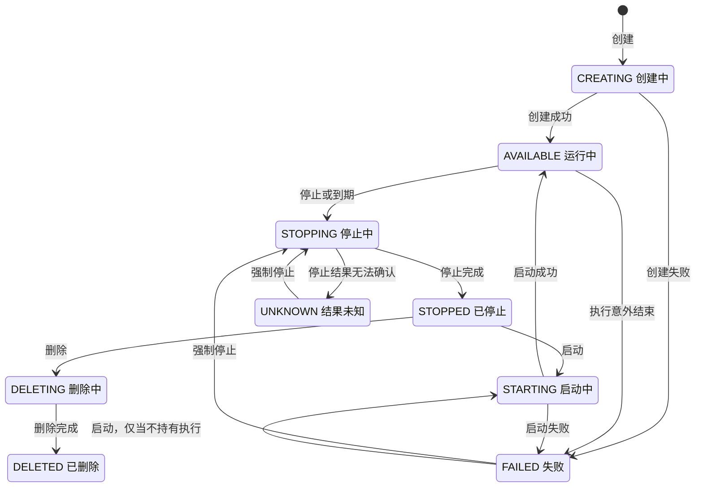

# Workspace

本页按操作说明 `kibotos.ctrl.v1.WorkspaceService`：Workspace 有哪些状态、每个操作在什么状态下被接受、请求字段的规则，以及失败之后怎样恢复。读者是用原生 API 管理 Workspace 的集成开发者。幂等键、版本校验与错误格式等通用规则见[调用约定](/integrate/native-api/conventions)。

## 概述 {#overview}

Workspace 是一台按 Template 启动的 MicroVM，加上它的 Volume、网络策略与到期设置。每次启动得到一轮新的执行（execution），`generation` 记录 Workspace 成功启动过的次数，即执行代（generation）；内存与进程不跨执行保留。

数据保留分三层，`retention_tiers` 字段逐层给出：

| 层级 `tier` | 路径 `paths` | 跨停止与启动 |
|---|---|---|
| `RETENTION_TIER_KIND_PROMISED` | Volume 的挂载路径，默认 `/data` | 保留。没有绑定 Volume 时 `availability` 为 `RETENTION_AVAILABILITY_NOT_DECLARED`，即没有承诺保留的路径 |
| `RETENTION_TIER_KIND_BEST_EFFORT` | `/`，即根文件系统的保留的可写层（retained layer） | 尽力保留，可能被重建，见下文 |
| `RETENTION_TIER_KIND_NONE` | `/tmp`、`/run` | 不保留 |

`BEST_EFFORT` 一层还报告可写层这一次是否沿用了上一次的内容：`continuity` 为 `RETENTION_CONTINUITY_CONTINUED` 表示沿用；为 `RETENTION_CONTINUITY_RESET` 表示重新建立，`reset_reason` 说明原因：`RETENTION_RESET_REASON_FIRST_START`（第一次启动）、`RETENTION_RESET_REASON_LAYER_UNAVAILABLE`（原来的可写层不可用）或 `RETENTION_RESET_REASON_TEMPLATE_CHANGED`（Template 变了）；无法确认时为 `RETENTION_CONTINUITY_UNKNOWN`。`capacity_bytes` 是可写层确认的实际容量，可写层建好之前没有。

需要承诺保留的数据只写进 Volume 的挂载路径。保留的可写层不是快照，可能因为可写层不可用或 Template 变化而重建。

## 状态 {#states}

| 状态 | 含义 |
|---|---|
| `WORKSPACE_STATE_CREATING` | 创建已被接受，正在调度（placement）、准备 Template 与启动 |
| `WORKSPACE_STATE_AVAILABLE` | 正在运行，可以申请会话凭证、访问数据面 |
| `WORKSPACE_STATE_STOPPING` | 正在停止 |
| `WORKSPACE_STATE_STOPPED` | 已停止，不再占用 CPU 与内存；Volume 与保留的可写层保留，继续占用存储容量 |
| `WORKSPACE_STATE_STARTING` | 正在启动新的执行 |
| `WORKSPACE_STATE_DELETING` | 正在删除 |
| `WORKSPACE_STATE_DELETED` | 已删除。仍可以用 `GetWorkspace` 读取，列表默认不返回 |
| `WORKSPACE_STATE_FAILED` | 最近一次操作失败，或运行中的执行意外结束；`failure` 给出 `reason`、`stage`、`retryable` 与 `message` |
| `WORKSPACE_STATE_UNKNOWN` | ctrl 无法确认上一条命令的结果，例如停止或删除在执行时限内没有完成 |
| `WORKSPACE_STATE_UNSPECIFIED` | 只表示字段没有给出，不是 Workspace 的状态 |



图中省略了一条通用规则：除 `DELETING` 与 `DELETED` 外，任何状态都接受 `DeleteWorkspace`。

### 持有执行 {#holds-execution}

「持有执行」指 Workspace 在某个 node 上还有没释放的 Instance 与资源预留。响应里没有字段直接给出它，但它决定 `FAILED` 的 Workspace 接受什么操作：

- 不持有执行：可以直接 `StartWorkspace`，也可以调整资源与 Volume 绑定。
- 仍持有执行（例如 VMM 意外退出、销毁失败）：先[强制停止](#force-stop)释放执行，再启动。

### 各操作接受的状态 {#admission}

| 操作 | 接受的状态 |
|---|---|
| `StartWorkspace` | `STOPPED`；`FAILED` 且不持有执行、没有开始过删除 |
| `StopWorkspace`（正常停止） | `AVAILABLE` |
| `StopWorkspace`（强制停止） | 见[强制停止](#force-stop) |
| `DeleteWorkspace` | 除 `DELETING`、`DELETED` 外的任何状态 |
| `UpdateWorkspaceMemory`、`UpdateWorkspaceCpu`、`UpdateWorkspaceVolumeBinding`、`ResizeWorkspaceWritableLayer` | 与 `StartWorkspace` 相同 |
| `UpdateWorkspaceNetworkPolicy` | `AVAILABLE`、`STOPPED` |
| `UpdateWorkspaceExpiration` | 设置到期：`AVAILABLE`。清除到期：另外接受 `STOPPED`，以及不持有执行、没有开始过删除的 `FAILED` |
| `UpdateWorkspaceLabels`、`UpdateWorkspaceAnnotations` | 除 `DELETED` 外的任何状态 |
| `RevokeWorkspaceDataPlane`、`CreateDataPlaneSession`、`CreateExposure` | `AVAILABLE` |
| `ExportWorkspace` | `STOPPED` 且绑定了 Volume |

- 状态不允许时返回 `failed_precondition`，`ErrorDetail.reason` 为 `CONFLICT`，Workspace 不变。
- 同一个 Workspace 有其他命令正在处理时，新的命令同样返回 `failed_precondition`。两个例外：`DeleteWorkspace` 取代正在处理的命令，被取代的命令以 `CANCELLED` 结束；强制停止取代正在处理的正常停止。
- 开始过删除的 Workspace 只接受再次 `DeleteWorkspace`，不再接受启动、强制停止与配置修改。

## 创建 {#create}

`CreateWorkspace` 的请求字段：

| 字段 | 说明 |
|---|---|
| `metadata.command_id` | 幂等键（command ID），必填，见[幂等键](/integrate/native-api/conventions#idempotency) |
| `spec.template` | `template_id` 必填；`revision` 可选 |
| `spec.resources` | `cpu_millis`、`memory_bytes` 必填，`ephemeral_disk_bytes` 可选 |
| `spec.volume` | Volume 绑定，省略时新建一个 Volume |
| `spec.network_policy` | 网络策略，省略时为 `DENY_ALL` |
| `spec.required_capabilities` | 可选，对承载 node 的额外能力要求，与 Template 声明的要求合并，同一个键取值冲突时返回 `failed_precondition`。可用的键取决于部署，一般留空 |
| `expiration` | 可选的到期设置：`timeout` 与 `action` |
| `labels`、`annotations` | 可选，调用方自己的键值数据 |

### Template 与 revision {#create-template}

- `revision` 留空时使用该 Template 当前的默认 revision。服务端把解析出的确切 revision 写进 `spec.template`，此后一直固定在这个 Workspace 上。
- Template 不存在返回 `not_found`；revision 不可选用（被撤回、被禁用或未获准入）时返回 `failed_precondition`。
- 一个 node 第一次使用某个 Template 时要先接收它的文件，`CREATING` 可能持续几分钟。这期间 `workspace.delivery` 报告进度，见[运行状况观测](/integrate/native-api/observability)。
- 平台运营方更换了 Platform 的默认 revision 之后，下一次显式的 `StartWorkspace` 会把 Workspace 换到新的 Platform，`spec.launch_binding_version` 随之加一；Template revision 不变。

### 资源 {#create-resources}

| 字段 | 规则 |
|---|---|
| `cpu_millis` | 毫核，大于 0。执行得到的 vCPU 数是毫核除以 1000 向上取整：`1500` 得到 2 个 vCPU，`500` 得到 1 个。单个执行能得到多少 vCPU 由承载它的 node 在启动时判定 |
| `memory_bytes` | guest 内存，必须是 MiB 的整数倍且不小于 128 MiB。执行得到的内存与请求值完全相同，上限取决于启动时的可用容量 |
| `ephemeral_disk_bytes` | 根文件系统可写层的容量，也是调度时预留的磁盘容量。0 表示由承载 node 的存储配置决定；非 0 时必须是 MiB 的整数倍。其中 1 MiB 留给写满之后的下一次启动，guest 里看到的可用空间比它少 1 MiB |

- 可写层与 Volume 从创建起占用存储池容量，停止不释放，直到删除。
- 返回的 `spec.resources.ephemeral_disk_bytes` 是请求值；可写层建好之后，实际容量在 `retention_tiers` 里 `BEST_EFFORT` 一层的 `capacity_bytes`。
- 存储池容量不足时返回可重试的 `resource_exhausted`。资源的上限与默认值取决于部署，见[限制与默认值](/reference/limits)。

### Volume 绑定 {#create-volume}

`spec.volume` 是一个 `WorkspaceVolumeBinding`，`mode` 取下面三者之一：

| `mode` | 效果 | `volume_id` | `mount_path` | `delete_with_workspace` 缺省值 |
|---|---|---|---|---|
| `WORKSPACE_VOLUME_MODE_NEW`（缺省） | 新建一个 Volume 并绑定 | 必须为空 | 缺省 `/data` | 开启 |
| `WORKSPACE_VOLUME_MODE_BOUND` | 绑定一个已有的 Volume | 必填 | 缺省 `/data` | 关闭 |
| `WORKSPACE_VOLUME_MODE_NONE` | 不绑定 Volume，没有承诺保留的路径 | 必须为空 | 必须为空 | 不能设置 |

- 一个 Workspace 至多绑定一个 Volume；一个 Volume 同时至多被一个未删除的 Workspace 绑定。`BOUND` 的 Volume 必须处于 `AVAILABLE` 且没有被绑定。
- `mount_path` 是 guest 中的规范绝对路径：不以 `/` 结尾，不含 `//`、`.` 或 `..` 段，最长 4096 字节。它不能是 `/`，也不能是 `/proc`、`/sys`、`/dev`、`/run`、`/tmp` 本身或其下的路径。
- `delete_with_workspace` 是绑定的属性，不是 Volume 的属性：开启时 `DeleteWorkspace` 物理删除这个 Volume，关闭时只解除绑定、Volume 回到 `AVAILABLE`。
- `NEW` 新建的 Volume 容量由部署的存储配置决定，之后可以用 `ResizeVolume` 扩容。
- 返回的 Workspace 里 `spec.volume` 总是 `BOUND` 或 `NONE`，带确切的 `volume_id`、`mount_path` 与 `delete_with_workspace`；`persistent_paths` 是挂载路径，没有 Volume 时为空。
- 建好之后改绑、解绑或改挂载路径，见 [Volume 绑定](#volume-binding)。

### 网络策略 {#create-network}

`spec.network_policy` 省略或 `mode` 未指定时为 `DENY_ALL`，不允许任何出站。需要访问公网时设为 `NETWORK_POLICY_MODE_PUBLIC_INTERNET`，并可以用 `allow`、`deny` 收窄目的地址，或引用 Egress 与 Resolver。规则见[网络策略与 DNS](/integrate/native-api/network-policy)。

### 到期 {#create-expiration}

`expiration` 是一个 `WorkspaceExpirationPolicy`：

- `timeout`：正的时长，从 ctrl 接受创建命令开始计时，创建耗时也计算在内。
- `action`：`WORKSPACE_EXPIRATION_ACTION_STOP` 或 `WORKSPACE_EXPIRATION_ACTION_DELETE`，必须明确给出。

省略 `expiration` 则不设到期时间。到期的完整规则见[到期](#expiration)。

### 返回与结果 {#create-result}

- `CreateWorkspace` 在 ctrl 接受命令后立即返回，Workspace 处于 `CREATING`，创建在服务端继续执行，调用方断开不影响它。
- 用 `GetWorkspaceCommand` 查询这条命令的结果，或轮询 `GetWorkspace` 直到状态变为 `AVAILABLE`、`FAILED` 或 `UNKNOWN`。判断方法见[返回时机与结果查询](/integrate/native-api/conventions)。
- 没有收到响应时，用同一个幂等键与完全相同的请求重发，得到同一个 Workspace。
- 创建失败的 Workspace 处于 `FAILED`，多数情况下 ctrl 已经销毁没有就绪的实例、释放了资源，可以直接 `StartWorkspace` 重试；失败的原因没有消除时，启动会以同样的原因失败。

请求示例（JSON）：

```json
{
  "metadata": {"command_id": "agent-42-create"},
  "spec": {
    "template": {"template_id": "kibotos-coding"},
    "resources": {"cpu_millis": 2000, "memory_bytes": 4294967296, "ephemeral_disk_bytes": 21474836480},
    "volume": {"mode": "WORKSPACE_VOLUME_MODE_NEW", "mount_path": "/data"},
    "network_policy": {
      "mode": "NETWORK_POLICY_MODE_PUBLIC_INTERNET",
      "deny": ["0.0.0.0/0", "::/0"],
      "allow": ["203.0.113.0/24"]
    }
  },
  "expiration": {"timeout": "28800s", "action": "WORKSPACE_EXPIRATION_ACTION_STOP"},
  "labels": {"team": "agents", "tenant": "acme"}
}
```

## 查询与列表 {#get-list}

- `GetWorkspace` 按 `workspace_id` 读取一个 Workspace，包括已删除的。它只读 ctrl 的记录，不访问 node。
- `ListWorkspaces` 的筛选条件：`states`（只返回这些状态）、`include_deleted`（一并返回已删除的，与 `states` 不能同时使用）、`label_selector`（按 label 筛选，见 [labels 与 annotations](#labels-annotations)）、`guest_condition`（按 guest 是否回应筛选，见[运行状况观测](/integrate/native-api/observability#guest-observation)）。分页规则见[调用约定](/integrate/native-api/conventions)。

## 启动 {#start}

`StartWorkspace` 的请求字段：

| 字段 | 说明 |
|---|---|
| `metadata.command_id` | 幂等键 |
| `workspace_id` | 目标 Workspace |
| `expected_expiration_revision` | 必填，等于当前的 `expiration.revision`，即使没有设置到期时间 |
| `expiration` | 可选的 `WorkspaceExpirationChange`：`policy` 为这次运行设置到期，`clear: true` 清除到期。与启动在同一次提交中生效 |

- 接受 `STOPPED` 的 Workspace，也接受不持有执行、没有开始过删除的 `FAILED` Workspace，不论失败发生在哪个阶段。
- 启动创建一轮新的执行，不恢复之前的内存与进程。成功后 `generation` 加一。Volume 重新挂载；保留的可写层可用时复用，不可用时重建。
- 平台运营方更换了 Platform 的默认 revision 之后，显式的启动会把 Workspace 换到新的 Platform。依赖新版 guest 的功能（例如目录监视、进程流续传），在部署升级之后要等 Workspace 重新启动一次才可用。
- 受理即返回，Workspace 处于 `STARTING`，用 `GetWorkspaceCommand` 查结果。
- 不带 `expiration` 时不改动到期设置，已经被消耗的到期设置也不会恢复。带了 `expiration` 时，倒计时从受理启动开始，启动耗时计算在内。
- 创建在建出自己的 Volume 之前就失败的 Workspace，启动时会把 Volume 建出来，ID、存储池与容量都不变。
- 绑定的 Volume 已经不存在时返回 `not_found`。绑定的 Volume 处于 `LOST` 时返回 `failed_precondition`，`reason` 为 `VOLUME_LOST`，不可重试，改绑另一个 Volume 或删除 Workspace，见 [Volume 与 Transfer](/integrate/native-api/volumes-transfers)。

## 停止 {#stop}

`StopWorkspace` 的请求字段：

| 字段 | 说明 |
|---|---|
| `metadata.command_id` | 幂等键 |
| `workspace_id` | 目标 Workspace |
| `expected_expiration_revision` | 必填，等于当前的 `expiration.revision` |
| `expiration` | 可选的 `WorkspaceExpirationChange`，与停止在同一次提交中生效 |
| `mode` | 缺省为正常停止；`STOP_MODE_FORCE` 为[强制停止](#force-stop) |

正常停止的过程与结果：

- 受理时立即撤销这个 Workspace 的全部会话凭证与 Exposure，数据面停止服务。
- 等 guest 停止写入并同步文件系统，然后停止 Instance、释放 CPU、内存与网络资源。应用已经交给内核的写入会被同步；还在应用自己缓冲区里的数据要由应用自己刷出。
- 响应的 `durability` 是 `STOP_DURABILITY_CONFIRMED`。KiboVM 后端还会把每块可写盘刷到存储设备，有一块没有确认时为 `STOP_DURABILITY_UNCONFIRMED`，Workspace 照常停止。部署使用哪种后端可向平台运营方确认。
- 同步失败或结果未知时，正常停止不会自动改为强制停止。
- `StopWorkspace` 最多等 1 分钟。超时返回可重试的 `unavailable`，停止继续执行，用原幂等键重发或用 `GetWorkspaceCommand` 查询。ctrl 持续重试 15 分钟仍不能完成时，Workspace 进入 `UNKNOWN`，此时可以强制停止或删除。
- 不带 `expiration` 时，`STOP` 类型的到期设置被消耗，`DELETE` 类型的保留并继续约束停止后的 Workspace。
- 停止后 Workspace 带 `last_stop`，说明是哪一次停止、由谁发起，见[停止原因](/integrate/native-api/observability#stop-cause)。

## 强制停止 {#force-stop}

`StopWorkspace` 的 `mode` 设为 `STOP_MODE_FORCE` 是强制停止，用于正常停止完成不了，或者 Workspace 停在 `FAILED`、仍持有执行的情况：

- 不等 guest 停止写入，只请 guest 做一次短时间的同步，然后停止 Instance、释放资源。Workspace 进入 `STOPPED`，`durability` 为 `STOP_DURABILITY_UNCONFIRMED`：最后的写入可能丢失，效果等同一次断电，下次启动时文件系统靠日志恢复一致。
- 绑定的 Volume 与保留的可写层都保留，之后可以 `StartWorkspace`。
- VMM 已经退出、没有可停的机器时，强制停止直接释放这次执行仍占着的 Volume、网络与可写层，同样进入 `STOPPED`。
- 需要服务端宣告能力名 `workspace.stop.force`。正常停止与到期停止失败时，服务端不会自行改为强制停止；只有宿主内存耗尽与 guest 关机两种情况由服务端发起强制停止，见[停止原因](/integrate/native-api/observability#stop-cause)。

没有其他命令在处理时，强制停止只接受下表中的 Workspace，其余返回 `failed_precondition`（`reason` 为 `CONFLICT`），不改变 Workspace：

| Workspace | 强制停止 |
|---|---|
| `AVAILABLE` | 接受 |
| `STOPPING` 或 `UNKNOWN`，正常停止仍在处理 | 接受。强制停止取代正常停止，原命令以 `CANCELLED` 结束 |
| `FAILED`，仍持有执行 | 接受，不论失败发生在哪个阶段 |
| `FAILED`，不持有执行 | 拒绝。直接 `StartWorkspace` |
| 开始过删除（曾有 `DeleteWorkspace` 被接受） | 拒绝。再次 `DeleteWorkspace` 完成删除 |

恢复一个 `FAILED` 的 Workspace，按下面的顺序：

1. 发送 `StopWorkspace`，`mode` 为 `STOP_MODE_FORCE`。成功时 Workspace 进入 `STOPPED`。
2. 发送 `StartWorkspace`。第 1 步返回 `failed_precondition` 时同样执行这一步：Workspace 本来就不持有执行。
3. 两步都被拒绝时，重新读取 Workspace，按它当前的状态处理。

VMM 意外退出（被杀、宿主内存不足，或者 guest 内核崩溃、guest 内重启使 VMM 退出）之后：

- node 保留这个已失败的 Instance，它仍占着 Volume、网络与可写层。
- Workspace 进入 `FAILED` 并仍持有执行，`StartWorkspace` 被拒绝。`failure.stage` 不设置，因为失败不发生在任何操作里。
- 强制停止让 node 释放这些资源，Workspace 进入 `STOPPED`，之后可以 `StartWorkspace`。

guest 卡住而 VMM 仍在运行时，Workspace 保持 `AVAILABLE`，强制停止照常停止这台机器。宿主内存耗尽与 guest 自己关机由服务端自动处理，guest 自己重启的处理见 [guest 自己重启或关机](/integrate/native-api/observability#guest-reboot)。

## 删除 {#delete}

`DeleteWorkspace` 的请求字段是 `metadata.command_id`、`workspace_id` 与必填的 `expected_expiration_revision`。

- 除 `DELETING`、`DELETED` 外的任何状态都接受删除，包括 `CREATING`、`FAILED` 与 `UNKNOWN`。正在处理的其他命令被取代，以 `CANCELLED` 结束。
- 受理时撤销全部会话凭证与 Exposure，然后停止并销毁执行，删除保留的可写层。
- 绑定的 Volume：`delete_with_workspace` 开启时物理删除；关闭时只解除绑定，Volume 回到 `AVAILABLE`，数据保留。随创建新建、但还没建出来的 Volume 一律删除。
- 最多等 1 分钟，超时返回可重试的 `unavailable`，删除继续执行，用原幂等键重发。ctrl 持续重试 15 分钟仍不能完成时，Workspace 进入 `UNKNOWN`，可以再次删除。
- 存储池暂时没有可用的 node 时，删除照样立即完成，文件等存储池有 node 可用后再删除；这期间 [`GetWorkspaceCleanup`](/integrate/native-api/observability#cleanup) 中保留的可写层与 Volume 删除两项报告 `CLEANUP_COMPONENT_STATE_PENDING`。
- 删除后的 Workspace 状态为 `DELETED`，仍可以用 `GetWorkspace` 读取，带 `include_deleted` 的列表也会返回；`labels` 与 `annotations` 一并保留。
- 开始过删除的 Workspace 只接受再次 `DeleteWorkspace`。

## 到期 {#expiration}

Workspace 可以设置一个到期时间，到期后由 ctrl 自动停止或删除它。`expiration` 字段：

| 字段 | 含义 |
|---|---|
| `revision` | 到期设置的版本，从 1 开始，每次修改加一。没有设置到期时间时也有版本号 |
| `expires_at` | 到期时刻；没有设置时为空 |
| `action` | 到期动作：`WORKSPACE_EXPIRATION_ACTION_STOP` 或 `WORKSPACE_EXPIRATION_ACTION_DELETE` |
| `claimed_command_id` | ctrl 已经开始执行到期动作时，对应命令的幂等键，以 `expiration/` 开头 |

设置与修改的入口：

| 入口 | 写法 |
|---|---|
| `CreateWorkspace`、`RestoreWorkspace` | `expiration`：`WorkspaceExpirationPolicy`，即 `timeout` 与 `action` |
| `StartWorkspace`、`StopWorkspace` | `expiration`：`WorkspaceExpirationChange`，`policy` 或 `clear: true`，与命令在同一次提交中生效 |
| `UpdateWorkspaceExpiration` | `expected_revision`（必填）加 `change`：`WorkspaceExpirationChange` |

规则：

- `timeout` 是正的时长，从 ctrl 接受这条请求开始计时。`action` 必须是 `STOP` 或 `DELETE`。
- `UpdateWorkspaceExpiration` 设置到期时间只在 Workspace 为 `AVAILABLE` 时接受。清除到期还接受 `STOPPED`，以及不持有执行、没有开始过删除的 `FAILED`，例如启动在调度阶段失败、留下了启动时设置的到期时间。
- `expected_revision` 或 `expected_expiration_revision` 与当前版本不一致时返回 `failed_precondition`，不是 `aborted`，见[版本校验](/integrate/native-api/conventions#expected-revision)。
- ctrl 已经开始执行到期动作（`claimed_command_id` 有值）之后，不能再通过延期取消它。
- 访问文件、执行命令都不会延长到期时间。
- 到期参数是命令输入的一部分：同一个幂等键换一个 `timeout` 会被判为冲突，不会静默延期。

到期时：

- `STOP`：ctrl 发起一次正常停止，`last_stop.cause` 为 `STOP_CAUSE_EXPIRED`。已经是 `STOPPED` 的 Workspace 保持停止，这次到期视为已经执行。到期停止失败时不会自动改为强制停止。
- `DELETE`：ctrl 删除 Workspace。随 Workspace 新建的 Volume 默认一起删除，挂载路径里的数据随之消失。
- 绑定执行的会话凭证（`lifetime` 为 `EXECUTION`）在到期时刻失效，见[申请会话凭证](/integrate/native-api/data-plane#session)。

## 调整资源 {#resources}

`UpdateWorkspaceMemory`、`UpdateWorkspaceCpu` 与 `ResizeWorkspaceWritableLayer` 修改 Workspace 下次启动使用的资源。它们只更新配置，不影响正在运行的执行，下次成功启动时生效。

前提条件：Workspace 不持有执行，即处于 `STOPPED`，或处于 `FAILED`、不持有执行且没有开始过删除。运行中的 Workspace 返回 `failed_precondition`，先停止；仍持有执行的 `FAILED` 先强制停止；开始过删除的只能再次删除。

| 方法 | 值 | 版本校验 |
|---|---|---|
| `UpdateWorkspaceMemory` | `memory_bytes`：MiB 的整数倍，不小于 128 MiB，是最终值而不是增量 | `expected_revision` 等于 `spec.resources_revision` |
| `UpdateWorkspaceCpu` | `cpu_millis`：大于 0，执行得到向上取整的 vCPU 数 | `expected_revision` 等于 `spec.resources_revision`，与内存共用 |
| `ResizeWorkspaceWritableLayer` | `capacity_bytes`：MiB 的整数倍的绝对目标，只能增大 | 没有，只有幂等键 |

- 内存与 CPU 共用 `resources_revision`：基于同一个版本先后提交的内存修改与 CPU 修改，后到的一个返回 `aborted`。版本不一致返回 `aborted`，`observed_workspace` 带当前版本。
- 设置为与当前相同的值直接成功，版本号不变。
- 成功只表示新值已经保存，不代表下次启动一定能分到足够的容量。启动因容量不足失败后，可以把资源调小再试。
- 被拒绝的修改不留下命令记录，见[幂等键](/integrate/native-api/conventions#idempotency)。
- 三项修改是相互独立的命令，没有一次修改多项的原子操作；需要同时修改时逐项提交，并处理中途失败。

可写层扩容：

- 目标等于当前容量时直接成功，不产生命令；小于当前容量时返回 `invalid_argument`；超出调度位置能容纳的容量时返回 `resource_exhausted`。
- 已经写入可写层的内容全部保留。从未启动过的 Workspace 只记录容量，第一次启动时按它建出可写层。
- 扩容在请求内完成，要扩展整个文件系统，可能需要几分钟；客户端超时要设得足够长，超时后用原幂等键重发。
- 平台运营方正在搬迁这个可写层时，返回可重试的 `unavailable`，搬迁结束后再试。

## Volume 绑定 {#volume-binding}

`UpdateWorkspaceVolumeBinding` 用一个完整的目标绑定替换 Workspace 当前的 Volume 绑定：

| 目标 | 效果 |
|---|---|
| `mode` 为 `BOUND`，`volume_id` 是当前 Volume | 修改挂载路径或 `delete_with_workspace` |
| `mode` 为 `BOUND`，`volume_id` 是另一个 Volume | 绑定那一个，解除当前这一个 |
| `mode` 为 `NONE` | 解除当前 Volume，不再绑定 |

- 请求字段：`metadata.command_id`、`workspace_id`、`expected_revision`（等于 `spec.binding_revision`，与资源版本各自独立）与 `volume`（完整的目标绑定，不是增量）。
- `NEW` 在这里不被接受，返回 `invalid_argument`：先用 `CreateVolume` 建好 Volume 再绑定。
- 前提条件与[调整资源](#resources)相同：Workspace 不持有执行。
- 目标 Volume 必须存在、处于 `AVAILABLE`、没有被其他未删除的 Workspace 绑定，并且这个 Workspace 已有的调度位置能访问它所在的存储池。不满足时分别返回 `not_found` 与 `failed_precondition`，绑定不变。
- 被解除或换掉的 Volume 一定保留，数据不变，回到 `AVAILABLE`，与它的 `delete_with_workspace` 无关；这个开关只决定 `DeleteWorkspace` 的行为。
- 新绑定在下一次成功启动时挂载，这次调用不启动、停止或重建任何东西。改了挂载路径后，旧挂载点留在可写层里，只是一个普通目录。
- 解除绑定后的 Workspace 没有承诺保留的路径，也不能导出。
- 提交与当前完全相同的绑定直接成功，`binding_revision` 不变。需要能力名 `workspace.volume_binding.update`。

## labels 与 annotations {#labels-annotations}

Workspace 有两组字符串到字符串的映射，供调用方保存自己的数据。ctrl 不解释它们，不据此调度、授权或计费。规则沿用 Kubernetes，Volume、Egress 与 Resolver 上的同名字段规则相同。

| | `labels` | `annotations` |
|---|---|---|
| 用途 | 需要据此筛选的短值 | 原样存取的任意值 |
| 可筛选 | 是，`List*` 的 `label_selector` | 否 |
| key | `[前缀/]名字`：前缀是小写 DNS 子域名，最长 253 字节；名字 1 到 63 字节，首尾是字母或数字，中间可以有 `-`、`_`、`.` | 同左 |
| value | 空，或最长 63 字节，字符规则同名字 | 任意不含 U+0000 的 UTF-8 |
| 合计上限（全部 key 与 value 的字节数） | 65536 | 262144 |
| 版本 | `labels_revision` | `annotations_revision` |

- **创建时给出**：`CreateWorkspace` 的 `labels`、`annotations` 与创建命令在同一个事务里写入，也参与幂等比较：同一个幂等键换一份数据重发会返回 `already_exists`。
- **筛选**：`ListWorkspaces` 的 `label_selector` 要求每一项的 key 存在且值逐字节相等，多项同时满足。翻页时 selector 必须与第一页相同。
- **修改**：`UpdateWorkspaceLabels`、`UpdateWorkspaceAnnotations` 整体替换映射，不做合并，传空映射即清空。`expected_revision` 与当前版本不一致返回 `aborted`，内容不变；内容与当前相同时成功且版本不变。两个版本互不影响，也不影响资源版本与绑定版本。已删除的 Workspace 不接受修改，返回 `failed_precondition`。
- **已删除的资源**：`GetWorkspace` 与带 `include_deleted` 的列表仍返回两组数据，也能被 selector 选中。
- **不是秘密**：能读取这个资源的调用方和 `kibo` 都能看到它们。只放可以公开的数据：token、密钥及由它们推出的值放在别处，访问控制也要另行实现，不能依靠某个 label。
- **能力名**：`workspace.labels`、`workspace.annotations`。较旧的服务端会静默丢掉未知字段，写入前先确认能力名存在。
- **保留的前缀**：`kibotos.app` 及其子域名形式的前缀留给 Kibotos 自己的组件使用，例如 E2B 兼容网关使用 `e2b.kibotos.app/` 与 `m.e2b.kibotos.app/`。ctrl 不据此拒绝请求，但不要在自己的数据里使用这些前缀。

## 查询命令结果 {#workspace-command}

`GetWorkspaceCommand` 按 `workspace_id` 与 `command_id` 返回一条 Workspace 命令的记录，`result` 是命令完成时的响应：

| `result` 字段 | 对应的命令 |
|---|---|
| `create`、`start`、`stop`、`delete` | `CreateWorkspace`、`StartWorkspace`、`StopWorkspace`、`DeleteWorkspace` |
| `expiration`、`network_policy`、`revoke_data_plane` | `UpdateWorkspaceExpiration`、`UpdateWorkspaceNetworkPolicy`、`RevokeWorkspaceDataPlane` |
| `memory`、`cpu`、`writable_layer`、`volume_binding` | `UpdateWorkspaceMemory`、`UpdateWorkspaceCpu`、`ResizeWorkspaceWritableLayer`、`UpdateWorkspaceVolumeBinding` |
| `labels`、`annotations` | `UpdateWorkspaceLabels`、`UpdateWorkspaceAnnotations` |

`status`、`error_code` 与 `error` 的判断方法见[返回时机与结果查询](/integrate/native-api/conventions)。服务端自己发起的命令（到期、宿主内存耗尽与 guest 关机后的停止）也能用它们的幂等键查询，幂等键可以从 `expiration.claimed_command_id` 或 `last_stop.command_id` 读到。

## 撤销数据面 {#revoke-data-plane}

`RevokeWorkspaceDataPlane`（字段 `metadata.command_id`、`workspace_id`）让一个运行中的 Workspace 的全部数据面访问立即失效，不重启 Workspace：

- 只接受 `AVAILABLE` 的 Workspace。
- 已签发的全部会话凭证失效，正在进行的数据面流与服务连接被中断。
- 经 `ProcessService` 启动的全部进程连同它们的后代被终止。
- Workspace 保持 `AVAILABLE`，`generation` 不变，之后可以重新申请会话凭证。
- 最多等 1 分钟，超时返回可重试的 `unavailable`，用原幂等键重发。
- 这个方法没有能力名，从 `v0.1.0` 起总是可用。

怀疑会话凭证泄露时使用它。只是想结束某个进程，用 `ProcessService/SendSignal`，见[数据面：文件与进程](/integrate/native-api/data-plane)。

## 相关文档 {#related}

- [调用约定](/integrate/native-api/conventions)：幂等键、版本校验、错误格式与分页。
- [运行状况观测](/integrate/native-api/observability)：guest 回应、内存饱和、停止原因与释放情况。
- [网络策略与 DNS](/integrate/native-api/network-policy)：`network_policy` 与 `UpdateWorkspaceNetworkPolicy`。
- [Volume 与 Transfer](/integrate/native-api/volumes-transfers)：Volume 的生命周期与导出、导入、恢复。
- [Workspace 生命周期](/guide/workspace-lifecycle)：从产品角度理解 Workspace 的生命周期。
