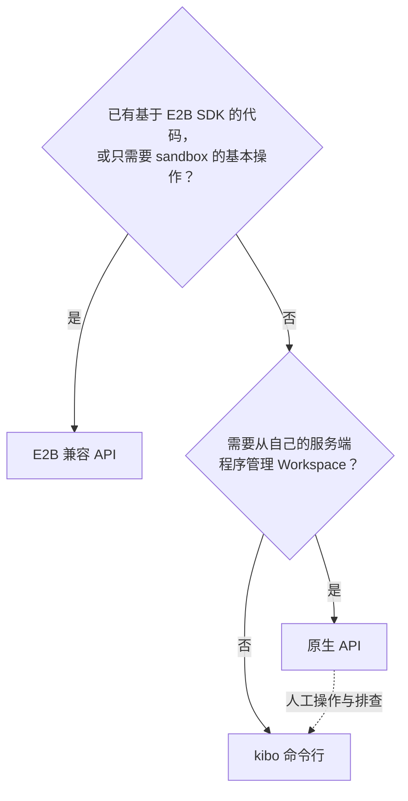

# 选择接入方式

Kibotos 提供三种接入方式。本页帮你选出合适的一种，并列出开始之前需要从平台运营方获得的信息。

## 怎样选择 {#choose}

| 方式 | 适合 | 不适合 |
|---|---|---|
| E2B 兼容 API | 已有 E2B 代码；按 sandbox 管理 Agent 运行环境；需要公开的应用端口域名 | 需要指定 CPU 与内存、Transfer、Resolver、桌面截图与键鼠 API |
| 原生 API | 需要完整能力与精确的语义控制（幂等、版本校验、能力协商、观测） | 只想快速跑通示例 |
| `kibo` 命令行 | 人工试用、脚本、排查线上问题 | 在你的产品里嵌入调用 |

三种方式操作的是同一批对象：E2B 的 sandbox 就是 Workspace，sandbox ID 就是 Workspace ID。用 E2B 接入的团队也可以用 `kibo` 查看和排查自己的 sandbox。

## 能力对比 {#comparison}

| 能力 | E2B 兼容 API | 原生 API | `kibo` |
|---|---|---|---|
| 创建、停止（暂停）、启动（恢复）、删除 | 支持 | 支持 | 支持 |
| 指定 CPU、内存、可写层容量 | 按部署默认值 | 支持 | 支持 |
| 进程、PTY、流续传 | 支持 | 支持 | 支持 |
| 文件读写、目录监视 | 支持（只监视一层） | 支持 | 支持 |
| Volume | 按名称创建，每个 sandbox 至多一个 | 创建、扩容、换绑、解绑 | 支持 |
| Transfer（导出与恢复） | 不支持 | 支持 | 支持 |
| 出网开关与地址规则 | 支持 | 支持 | 支持 |
| 经 SOCKS5 出口离开 | `egressProxy`（不带 TLS） | Egress（可带 TLS 与 UDP） | 支持 |
| 自选 DNS 上游 | 不支持 | Resolver | 支持 |
| 访问 guest 内端口 | 应用端口域名 `{port}-{sandboxID}.<domain>` | 服务连接、公开 URL | 本机代理与转发、公开 URL |
| 桌面截图与键鼠 | 不支持 | 支持 | 支持 |
| 运行状况观测 | sandbox 指标（部署开启时） | guest 回应、内存饱和、停止原因、清理结果 | 支持 |
| 调用方自有数据 | metadata | labels 与 annotations | 支持 |

## 开始之前 {#prerequisites}

向平台运营方获取下面的信息。凭证类信息请通过安全渠道传递，不要写进代码仓库、聊天记录或工单。

### E2B 兼容 API {#prerequisites-e2b}

| 信息 | 示例 |
|---|---|
| API key | 从安全渠道获得，保存在文件或密钥管理系统里 |
| sandbox 域名 | `sandbox.example.com` |
| 控制 API 地址 | `https://api.sandbox.example.com` |
| 可用的 Template ID | `kibotos-minimal`、`kibotos-coding`、`kibotos-desktop`、`kibotos-memoh` 中部署实际提供的那些 |
| 部署的默认资源与最长有效期 | 默认 1 核、1 GiB、5 GiB，默认有效期 1 小时 |

本地需要 Node.js 22 或更新版本与 npm。

### 原生 API 与 kibo {#prerequisites-native}

| 信息 | 示例 |
|---|---|
| ctrl 地址 | `https://ctrl.example.com:18092` |
| Operator 注册密钥 | 一次性文件，默认 1 小时内有效 |
| `kibo` 程序 | 发布包中的 `kibo_<版本>_linux_amd64`、`kibo_<版本>_darwin_arm64` 或 `kibo_<版本>_darwin_amd64` |
| proto 定义 | 与部署版本一致的 `proto/` 目录，只在自己生成客户端时需要 |

::: warning 注册密钥与身份
注册密钥里包含一把引导私钥，要当作凭证保管，用完立即删除。注册得到的 Operator 身份对所在部署拥有完整的管理权限，每个程序使用自己的一份。见[身份、凭证与访问控制](/security/credentials)。
:::

## 下一步 {#next}

- [通过 E2B SDK 接入](/quickstart/e2b-sdk)
- [通过原生 API](/quickstart/native-api)
- [通过 kibo 命令行](/quickstart/kibo-cli)
