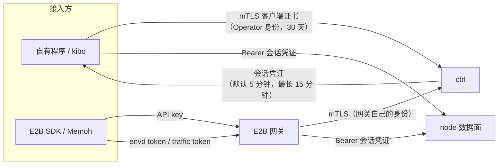

# 安全模型

本页概括 Kibotos 怎样隔离 Agent 运行的代码、怎样认证每一类请求、数据存在哪里，以及接入方需要承担哪些责任。读者是安全与合规评审人员，以及负责接入的技术负责人。各主题的细节见本节的其他页面。

## 威胁模型 {#threat-model}

Kibotos 假定 **Workspace 里运行的代码不可信**：它可能是 LLM 生成的代码、Agent 安装的第三方依赖，或者被提示注入操纵的工具调用。平台要保证这些代码：

- 不能影响宿主机与其他 Workspace；
- 只能访问网络策略允许的外部地址，不能访问平台内部与云厂商的元数据服务；
- 拿不到访问控制面的凭证。

同时，访问 Workspace 的每一个入口都要认证：控制面要求客户端证书，数据面要求 ctrl 签发的短期凭证，E2B 入口要求 API key 与按 sandbox 推导的 token。

## 安全边界 {#boundaries}

| 边界 | 机制 | 详见 |
|---|---|---|
| Workspace 与宿主、Workspace 之间 | 每个 Workspace 一台 MicroVM（Firecracker 或 KiboVM），有自己的内核；VMM 以非特权系统账户运行，并有后端自己的沙箱 | [隔离与网络安全](/security/isolation) |
| Workspace 与网络 | 默认拒绝出站；私网、链路本地（含云元数据地址）、平台管理网段与其他 guest 的地址永远不能直连 | [隔离与网络安全](/security/isolation#network) |
| 接入方与控制面 | mTLS，客户端证书由 ctrl 自己的 CA 签发，只信任 ctrl 自己的服务端 CA | [身份、凭证与访问控制](/security/credentials) |
| 接入方与数据面 | 短期 bearer 凭证，限定 scope、Workspace 与执行代，由 node 校验签名 | [身份、凭证与访问控制](/security/credentials#session) |
| E2B 接入方与网关 | API key 访问控制 API；按 sandbox 推导的 envd token 与 traffic token 访问数据面 | [身份、凭证与访问控制](/security/credentials#e2b) |
| 公开 URL | 随机地址，没有其他访问控制；带有效期，Workspace 停止时撤销 | [隔离与网络安全](/security/isolation#exposure) |

## 认证路径 {#authentication}

- 控制面没有明文或匿名入口。仅信任 ctrl 的服务端证书（例如浏览器）不能获得任何权限。
- 会话凭证由 ctrl 签名（JWS，`EdDSA`），node 用自己的时钟校验，允许 30 秒偏差。
- E2B 的 token 不在任何地方保存，由网关密钥按 sandbox ID 推导；伪造的 token 在网关直接被拒绝，不会到达 ctrl。

## 数据 {#data}

| 数据 | 存放位置 | 保留 |
|---|---|---|
| Volume | node 存储池中的块文件 | 显式删除或随 Workspace 删除之前一直保留 |
| 根文件系统可写层 | node 上，属于这个 Workspace | 尽力保留，可能重建 |
| `/tmp`、`/run`、内存 | MicroVM 内 | 每次停止即丢失 |
| Transfer 归档 | 平台对象存储 | 默认 24 小时后删除；可以随时删除 |
| labels 与 annotations | ctrl | 随资源保存，对所有能读该资源的调用方可见 |
| Egress 口令 | ctrl，加密保存 | 只写，任何读取都不返回 |

详见[数据持久性与保护](/security/data)。

## 不会被记录的内容 {#not-logged}

平台组件的日志不记录下面的内容，任何日志级别都一样：

- 进程的参数、环境变量与输入输出，文件内容，用户给出的路径与文件名，剪贴板与屏幕内容；
- token、私钥、口令、注册密钥、API key 与会话凭证（需要区分时只记 key ID、证书序列号或摘要的前 8 个十六进制字符）；
- Exposure 地址里随机的那部分；
- 带查询串的完整 URL（网关只记录路由模式，例如 `GET /sandboxes/{id}`）。

平台运营方开启链路追踪时，trace 只包含方法名、路由模式、状态码、对象 ID（Workspace、Instance、Volume、Transfer、Template、Exposure、命令 ID）与耗时；请求路径、查询串、主机名、对端地址、labels 与 annotations、文件名、凭证与请求响应体都不进入 trace。

## 接入方的责任 {#shared-responsibility}

| 责任 | 做法 |
|---|---|
| 保管身份与密钥 | 注册密钥用完即删；Operator 身份目录只给一个程序使用，权限 `0700`；API key 放在密钥管理系统里 |
| 最小网络权限 | 不需要联网的 Workspace 保持 `DENY_ALL`；需要时用 `allow`、`deny` 收窄 |
| 不在 labels、annotations、Resolver 的 URL 里放秘密 | 它们对所有能读资源的调用方可见 |
| 区分持久与临时数据 | 需要保留的数据写进 Volume；敏感的临时数据写 `/tmp` |
| 谨慎使用公开 URL | Exposure 地址没有访问控制，只用于可以公开的内容 |
| 处理 Agent 产出的内容 | Workspace 里的页面与文件是不可信内容，在你的产品中展示前按不可信输入处理 |

## 下一步 {#next}

- [身份、凭证与访问控制](/security/credentials)
- [隔离与网络安全](/security/isolation)
- [数据持久性与保护](/security/data)
