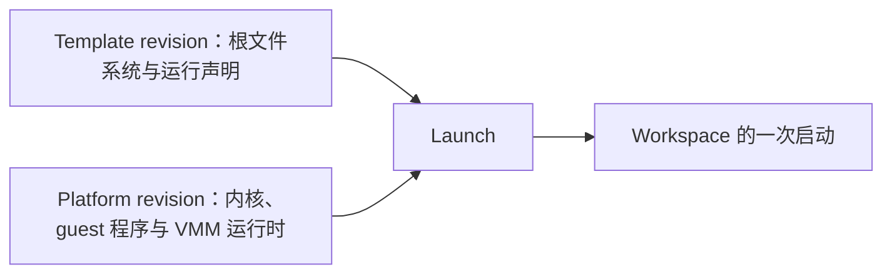

# Template 与 Platform

本页说明 Workspace 的运行环境从哪里来：Template 与 Platform 各自固定什么、版本怎样选定、Template 能声明哪些运行要求、根文件系统里哪些内容会保留，以及两种虚拟化后端有哪些对接入方可见的差异。读者是选择或评估 Template 的接入开发者与架构师。

## 概述 {#overview}

| 对象 | 固定什么 | 谁来选 |
|---|---|---|
| Template | Workspace 的根文件系统（只读的 ext4 镜像）与运行声明：默认执行账号、PATH、shell、要求的 guest 能力、根文件系统容量、对 Platform 的要求 | 接入方：创建 Workspace 时给出 Template ID，可以再指定 revision |
| Platform | 一种后端的启动输入：内核、guest 程序与 VMM 运行时。后端有 Firecracker 与 KiboVM 两种 | 平台运营方：每类 Platform 有一个默认 revision |
| Launch | 一次启动实际使用的 Template revision 与 Platform revision 的组合 | ctrl 在创建与启动时计算，接入方不需要提供 |



Template 与 Platform 各自独立构建、发布与批准。同一个 Template 可以运行在任一种后端上，只要 Platform 满足它声明的要求：架构、guest 协议、根文件系统契约与就绪语义一致，并且 guest 提供它要求的全部能力。部署里用的是哪种后端由部署配置决定，可向平台运营方确认。

Template ID 形如 `kibotos-coding`。内置的四个 Template 见[内置 Template](/templates/builtin)；自己构建的见[自定义 Template](/templates/custom)。

## revision {#revisions}

- 每个已发布的 Template 有一个或多个 revision。revision 是由内容决定的不可变标识，形如 `sha256:…`：产物的字节变化就得到新的 revision；只改运行声明（例如进程默认配置）也得到新的 revision，但复用原来的根文件系统。
- **默认 revision** 是不指定版本时使用的那个，由平台运营方设定。
- **创建时固定。** `kibo workspace create --template kibotos-coding` 在创建时解析当前的默认 revision，并把它固定到这个 Workspace 上；`--template-revision` 显式指定一个 revision。之后默认 revision 改变，已有的 Workspace 不受影响；一个 Workspace 的 Template revision 在它的整个生命周期里不变，停止、启动也一样。
- **Platform 随启动更新。** 每次显式启动 Workspace（`kibo workspace start`）时，ctrl 把它换到所在 PlatformKey（后端、架构、内核系列、guest 协议与根文件系统契约相同的一类 Platform）当前的默认 revision，Template revision 不变。换过时，JSON 输出的 `spec.launch_binding_version` 加一。所以平台运营方更新内核或 guest 程序后，已有的 Workspace 在下一次启动时用上新版本。
- 被 Workspace 引用的 revision 与它的数据会一直保留，不会因为默认值改变而被清理。

## 准入 {#admission}

一个 revision 能否被新的 Workspace 选用，以及哪个 revision 是默认值，由平台运营方管理：新发布的 revision 要经批准才能选用，也可以被停用或永久撤回。停用或撤回不影响已经用它创建的 Workspace，它们继续运行，不会被迁移。

`kibo template list` 与 `kibo template get` 的 `SELECTION` 显示准入状态：

| 值 | 含义 |
|---|---|
| `SELECTABLE` | 可以用它创建 Workspace |
| `NOT_SELECTABLE` | 不能选用，`Selection reason` 说明原因：`WITHDRAWN`（已撤回）、`ADMIN_DISABLED`（被停用）或 `ADMISSION_REJECTED`（准入被拒） |

用不可选用的 revision 创建 Workspace 以 `failed_precondition` 失败，退出码 `13`。发布与批准的命令要点见[自定义 Template](/templates/custom#publish)。

## 查看可用的 Template {#discover}

### 用 kibo {#discover-kibo}

```bash
kibo template list
kibo template list --selection any --wide
kibo template get kibotos-coding
```

- `list` 默认只列可以选用的 revision（`--selection selectable`）；`--selection not-selectable` 或 `any` 列出其他的。`--delivery` 按分发状态筛选：`any`（默认）、`ready`、`not-ready`、`unknown`。
- 表格列是 `TEMPLATE`、`DEFAULT REVISION`（缩短显示，`--wide` 显示完整值）、`SELECTION` 与 `DELIVERY`。
- `get` 显示名称、说明与默认 revision 的详情：revision、发布时间、准入状态与原因、分发状态与原因、观测时间、来源记录，以及 `Required capabilities`（Template 对 node 的能力要求）。`--revision` 查看指定的 revision。
- `DELIVERY` 是这个 revision 在 node 上的分发情况：`READY`、`NOT_READY` 或 `UNKNOWN`，`NOT_READY` 时 `Delivery reason` 给出 `DISTRIBUTING`、`CAPABILITY_MISMATCH`、`NO_SUPPORTED_PATH`、`OBSERVATION_STALE` 或 `PREPARATION_FAILED`。node 第一次运行某个 revision 时要先下载并校验它，这时创建会在 `CREATING` 停留更久。

### 用原生 API {#discover-native}

程序用 `TemplateService` 的 `ListTemplates`、`GetTemplate` 与 `GetTemplateRevision` 读取同样的信息，见[概述与协议](/integrate/native-api/overview)。

### 用 E2B SDK {#discover-e2b}

E2B 创建 sandbox 时给出的 template 名就是 Template ID，使用它当前的默认 revision：

```javascript
import { Sandbox } from 'e2b'

const sandbox = await Sandbox.create('kibotos-coding', {
  apiKey: process.env.E2B_API_KEY,
  domain: process.env.E2B_DOMAIN,
})
```

API key 与域名由平台运营方提供，完整的接入方式见 [sandbox 生命周期](/integrate/e2b/sandboxes)。

## guest 能力 {#guest-capabilities}

Template 定义里的 `guest.capabilities` 列出这个 Template 要求 guest 提供的能力。ctrl 只把它与 guest 提供了全部这些能力的 Platform 组合；每个 Template 都必须要求 `application-config.v1`。

| 能力名 | 含义 |
|---|---|
| `filesystem.v1` | 文件的元数据操作与 `/v1/files` 文件传输 |
| `process.v1` | 执行命令、终端与进程控制 |
| `application-config.v1` | 启动时下发应用配置：默认执行账号与进程默认配置、Volume 挂载、主机名与 DNS |
| `service.unix-stream.v1` | 服务连接到 guest 里受管目录下的 Unix socket，例如桌面的 VNC socket |
| `desktop.v1` | 桌面截图与键鼠输入 |

- 内置 Template 都要求前三项，两个桌面 Template 另外要求后两项，见[内置 Template](/templates/builtin)。
- 目录监视、进程流续传与连到 TCP 端口的服务连接由 Platform 交付的 guest 程序提供，node 在每次操作时按运行中的 guest 声明的能力检查，不需要在 Template 里声明。
- 这些是 guest 的能力名，与 ctrl 宣告、`kibo` 检查的能力名（例如 `workspace.desktop`）是两套名字，后者见[能力名清单](/reference/capabilities)。

## 进程默认配置 {#process-defaults}

Template 定义里的 `process_defaults` 声明经进程、文件与桌面接口运行的程序默认以什么身份、什么环境运行：

| 字段 | 说明 |
|---|---|
| `user` | 默认执行账号：受管进程、文件操作与桌面会话都以它运行。不能是 `root`；必须在镜像的 `/etc/passwd` 里，uid 与 gid 都不为 0，并且有 home。不声明时一切以 root 运行，也就没有桌面 |
| `shell` | 绝对路径。请求的命令为空时执行它，例如不带命令的 `kibo workspace terminal`；不声明时为 `/bin/sh`。命令非空时直接执行，不会经过这个 shell |
| `path` | 完整的 `PATH`。不声明时为 `/usr/local/sbin:/usr/local/bin:/usr/sbin:/usr/bin:/sbin:/bin`；声明为空字符串表示空的 `PATH` |

- 受管进程的环境只有 `PATH`、执行账号的 `HOME`（取自 `/etc/passwd`）、终端会话里的 `TERM=xterm`，以及请求自己给出的变量；请求里的 `PATH` 优先于 Template 的声明。镜像的 `ENV`、宿主机的环境与 shell 初始化文件都不生效。
- 不指定工作目录时，进程在执行账号的 home 目录启动。
- 请求可以显式选择 `root`；声明的账号与 `root` 以外的账号名以 `invalid_argument` 拒绝。
- 声明的账号在运行中被删除、改名或变得不可用时，Workspace 照常运行，以它执行的请求以 `failed_precondition` 失败，`root` 照常可用，桌面不可用。
- 每次启动时，Volume 挂载路径的顶层目录交给声明的账号。

各字段的写法见 [Template 定义文件](/templates/custom#definition)，`kibo` 里的用法见[管理 Workspace](/integrate/kibo/workspaces)。

## 根文件系统与可写层 {#rootfs-and-layers}

- **根文件系统不可变。** 同一个 revision 的每个 Workspace 都从完全相同的只读根文件系统启动。
- **可写层属于 Workspace。** 运行中在 Volume 以外写入根文件系统的内容（安装的软件包、home 目录里的文件）落在这个 Workspace 自己的可写层上，容量由创建时的 `--disk` 决定。停止后可写层尽力保留，下次启动时继续使用；它也可能被重建，例如第一次启动、node 上的可写层不可用、Template 变化。`kibo workspace get --wide` 的 `Persistence` 一节给出可写层这一次是延续还是重建，以及重建的原因。
- **只有 Volume 承诺保留。** 需要保留的数据写进 Volume 的挂载路径（默认 `/data`）。`/tmp`、`/run` 不保留，内存与进程在停止后都不保留。可写层的保留不是快照，也不能用来复制 Workspace。
- **已有环境不会自动获得安全更新。** 根文件系统随 revision 固定，平台运营方发布新的 revision 后，要用新 revision 创建新的 Workspace，再把数据经 Volume 换绑或 Transfer 带过去，见 [Volume 与数据迁移](/integrate/kibo/storage)。内核与 guest 程序随 Platform 更新，在下一次显式启动时生效。

数据保留的完整边界见[数据持久性与保护](/security/data)。

## Firecracker 与 KiboVM {#backends}

两种后端都是正式支持的后端，各自维护运行与验收证据。接入方用到的接口与 Template 在两者上相同；下面这些情形的表现不同：

| 情形 | Firecracker | KiboVM |
|---|---|---|
| 正常停止的落盘确认 | guest 停止写入并同步文件系统后，`durability` 为 `STOP_DURABILITY_CONFIRMED` | 还要把每块可写盘刷到存储设备；有一块没有刷完时 `durability` 为 `STOP_DURABILITY_UNCONFIRMED`，Workspace 照常停止 |
| guest 自己重启（`reboot -f`、`echo b > /proc/sysrq-trigger`） | node 在同一个 Instance 上启动新的 VMM，Workspace 保持 `AVAILABLE`，执行代与会话凭证不变；guest 回来之前数据面新请求返回可重试的 `unavailable`。10 分钟内复位超过 3 次时进入 `FAILED` | 复位与 VMM 故障无法区分，按故障处理，Workspace 进入 `FAILED`；用强制停止再启动恢复 |
| guest 自己关机（`poweroff -f`） | VMM 不随 guest 关机退出，服务端不会因此停止 Workspace；用强制停止收回 | 服务端自行对它执行强制停止，Workspace 进入 `STOPPED`，停止原因为 `STOP_CAUSE_GUEST_SHUTDOWN`，`durability` 为 `STOP_DURABILITY_UNCONFIRMED`；直接启动即可继续使用 |

- 重启与关机时，Volume 与可写层都保留，内存与进程不保留，没有落盘的写入可能丢失。
- Firecracker 的 guest 内核要以 `psi=1` 启动才统计内存压力（`kibo workspace get` 的 `Guest memory` 一行），本版本的 Firecracker Platform 已经带上。

完整说明见 [guest 自己重启或关机](/integrate/native-api/observability#guest-reboot)与[停止原因](/integrate/native-api/observability#stop-cause)。

## 下一步 {#next-steps}

- [内置 Template](/templates/builtin)
- [自定义 Template](/templates/custom)
- [桌面 Template 规范](/templates/desktop)
- [管理 Workspace](/integrate/kibo/workspaces#create)
- [核心概念](/guide/concepts)
